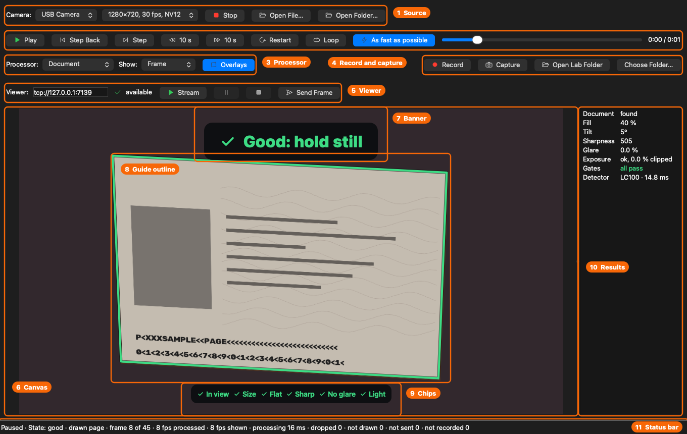
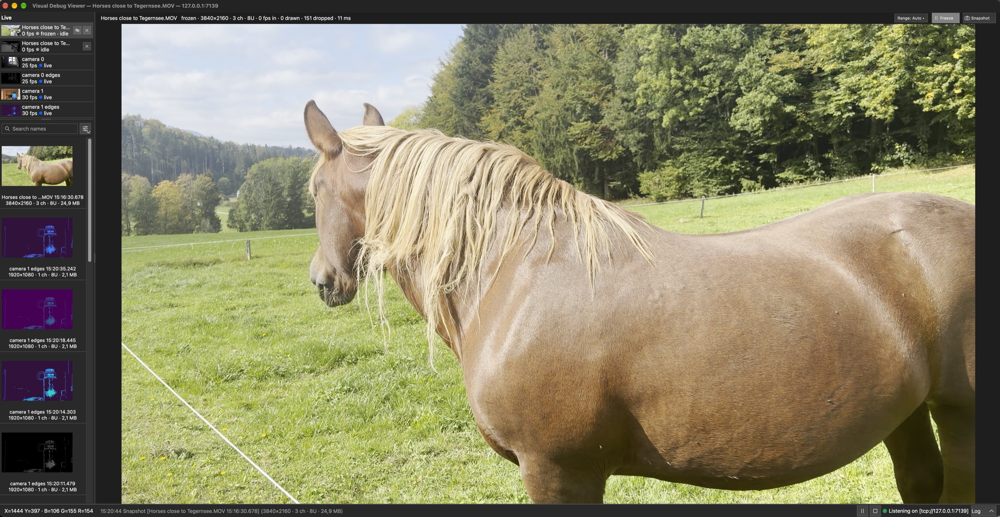
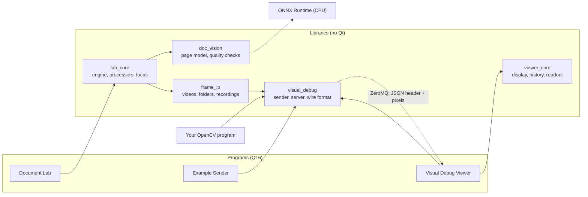

# ID Vision Lab

[](https://github.com/mbuster8/id-vision-lab/actions/workflows/ci.yml)
[](https://github.com/mbuster8/id-vision-lab/actions/workflows/codeql.yml)
[](LICENSE)

A lab for reading identity documents with a camera, on this computer, and a visual debugger for OpenCV that shows
every step of your own code. The **Document Lab** finds a passport's data page in a camera's frames or a recording,
judges whether it can be read, and tells the user what to change; reading the machine-readable zone (MRZ) and the
chip come next. The **Visual Debug Viewer** shows any image or camera frame your OpenCV program sends it, with the
original value of every pixel.

This started as my bachelor's thesis in 2013, a visual debugger for Qt 4 and OpenCV 2.4 on Ubuntu. In 2026 I
brought it back, ported to Qt 6 and OpenCV 5, tested, documented, and grown into the Document Lab; see
[what changed since 2013](#what-changed-since-2013).

## Contents

- [What's in it](#whats-in-it)
- [The Document Lab](#the-document-lab)
- [The Visual Debug Viewer](#the-visual-debug-viewer)
- [Quick start](#quick-start)
- [Show your own images in the viewer](#show-your-own-images-in-the-viewer)
- [Everyday commands](#everyday-commands)
- [How it fits together](#how-it-fits-together)
- [Platforms](#platforms)
- [Roadmap](#roadmap)
- [Documentation](#documentation)
- [Project layout](#project-layout)
- [What changed since 2013](#what-changed-since-2013)
- [Licence](#licence)

## What's in it

| Program | What it is for |
|---|---|
| **Document Lab** | The workbench for document-reading code: a camera or a replayed video, image, folder or recording through a processor, with guidance, focus on the page, recording, capture and streaming to the viewer ([Running the Document Lab](docs/user-guide.md#running-the-document-lab)) |
| **Visual Debug Viewer** | Shows every image and live frame sent to it: zoom, history, pixel values, display ranges, HDR, overlays ([Running the viewer](docs/user-guide.md#running-the-viewer)) |
| **Visual Debug Example Sender** | A small Qt app that opens an image and sends it, to show how a GUI program uses the library ([Running the example sender](docs/user-guide.md#running-the-example-sender)) |
| `live_sender` | Streams a camera, a video file, a phone's HDR video or a test pattern to the viewer as live channels ([Running live_sender](docs/user-guide.md#running-live_sender)) |
| `pipeline_demo`, `minimal_sender`, `overlay_sender` | Command-line examples: an OpenCV pipeline that sends every stage, the smallest sender, an image with overlays ([The programs](docs/user-guide.md#the-programs)) |
| Python sender | `python/visual_debug.py`: a numpy array to the viewer, overlays and all ([its README](python/README.md)) |

Underneath are five libraries that never use Qt, so each fits any C++ program: `visual_debug` (the sender and the
viewer's server), `viewer_core` (the viewer's logic), `frame_io` (videos, image folders, recordings), `doc_vision`
(the page model and the quality checks) and `lab_core` (the Document Lab's engine and processors). See
[How it fits together](#how-it-fits-together).

## The Document Lab

The workbench for document-reading code. A camera (an iPhone through Continuity Camera too) or a video, image,
folder or recording runs through a processor on a thread of its own, and the result shows on the lab's canvas,
the same zoomable canvas as the viewer's, with what the processor found drawn over the frame and listed beside it.
It replays every frame in order and goes to any frame of a video, records frames losslessly as PNG folders,
captures one at full resolution, and streams its frames to the viewer, or sends it one, when asked, showing
whether the viewer is there. Its processors find edges, a simple outline of a light four-sided shape, or a
passport's data page.

The **Document** processor guides the user to a page the next steps can read. DocsaidLab's DocAligner LC100
(Apache-2.0), a small page model run on ONNX Runtime, finds the page's corners; six checks (in view, size, flat,
sharp, no glare, light) judge it; and one hint at a time says what to change, with the page outlined in red until
everything passes and it turns green. Where the lab can set a camera's own focus (a UVC camera such as the
Logitech C920 on macOS, or a camera whose driver offers focus on Windows), it focuses on the page itself when a
steady page stays blurred, and on the spot you click; where it cannot, it says so
([Focus on the page](docs/user-guide.md#focus-on-the-page), [ADR-005](docs/ADR/ADR-005-camera-focus.md)).
Everything runs on this computer, and the lab never downloads anything: no frame leaves it unless you stream or
send it to a viewer.



1. **Source**: a camera and its format, with Start or Stop, or Open File… and Open Folder… to replay a video,
   an image, a folder of images or a recording.
2. **Replay**: play and pause, step a frame either way, ten seconds back or forward, restart, loop, as fast as
   possible, and the position in the replay.
3. **Processor**: what runs on each frame (None, Edges, Outline (simple) or Document), what the canvas shows (the
   frame or a processor's picture), and whether what the processor found is drawn over it.
4. **Record and capture**: record every frame processed, losslessly; keep the frame on screen at full
   resolution; open or choose the lab's folder for both.
5. **Viewer**: the Visual Debug Viewer's address and whether it is there; stream the frames to it, pause or stop
   the stream, or send it one frame.
6. **Canvas**: the frame, zoomed with the wheel, panned with a drag and fitted with a double-click; during a
   camera run, a click focuses the camera there.
7. **Banner**: one hint at a time, what to change or "Good: hold still".
8. **Guide outline**: the document the page model found, red until every check passes, then green.
9. **Chips**: the six checks at once (in view, size, flat, sharp, no glare, light).
10. **Results**: what the processor found, with a failing value in red beside its limit.
11. **Status bar**: the run, its news (the document's state, a focus note, why something failed), the source, the
    frame, the frames processed and shown per second, the processing time, and the frames dropped, not drawn, not
    sent and not recorded.

The picture is made by `document_lab_picture` ([build guide](docs/build-guide.md#the-document-labs-picture)),
from the real window and page model on a drawn page.

## The Visual Debug Viewer

An OpenCV program calls one function, and the image appears in the viewer, a separate window where you can zoom
into it, pan around and read the original value of any pixel, whether it is 8-bit, 16-bit, signed or floating
point.



- **OpenCV's integer and floating-point images**: 8- and 16-bit integers, signed or not, 32-bit integers, and
  32- and 64-bit floating point, one to four channels. The pixel readout always shows the original values, never
  the 8-bit picture on screen.
- **A history** of thumbnails you can rename, duplicate, delete (with undo), search and sort, kept between
  sessions if you want.
- **Live channels** for cameras and video: the newest frame in place, with its frame rate, frames drawn and
  dropped, and its age; Freeze, Snapshot and Mute; up to eight at once.
- **Display range and colours**: Auto, Hold and Fixed ranges, Grey, Turbo and Viridis maps, per image name, and a
  histogram of the picture in view whose range ends you can drag.
- **HDR video**: HLG and PQ frames tone-mapped for an SDR screen (ITU-R BT.2100, BT.2408), every value still
  readable.
- **Overlays**: shapes a sender attaches to an image or a frame (a document's outline, a photo, an MRZ band),
  drawn as see-through highlights, sharp at any zoom, behind one switch.
- **Show Clipping** marks the pixels at the ends of the range; **region statistics** (Shift-drag) give a
  rectangle's minimum, maximum, mean and σ per channel.

The **[tour of live channels](docs/live-channels-tour.md)** tries every live feature in nine stops, with
`live_sender` and what to expect at each.

## Quick start

### macOS

With the Xcode Command Line Tools and [Homebrew](https://brew.sh) installed, from a clone of this repository:

```sh
brew install cmake ninja pkgconf qt opencv zeromq cppzmq nlohmann-json googletest onnxruntime
cmake --preset debug
cmake --build --preset debug
```

The first configure downloads the Document Lab's page model (4.8 MB) into a cache of your own and checks its
SHA-256; the [build guide](docs/build-guide.md#the-models) says where, and how to build without a network.

**The Document Lab:**

```sh
open build/debug/apps/document_lab/document_lab.app
```

Start it with `open` (or from Finder), so that macOS asks for camera access for the lab. Choose **Document** as
the processor, press **Start** and hold a passport open at its photo page to the camera, or **Open File…** a
video.

**The Visual Debug Viewer:**

```sh
open build/debug/apps/viewer/visual_debug_viewer.app
build/debug/examples/pipeline_demo/pipeline_demo
```

`open` returns before the viewer is ready, so wait until its status bar says `Listening on [tcp://127.0.0.1:7139]`
before running `pipeline_demo`. It runs an OpenCV pipeline and sends ten images: colour, alpha, greyscale, signed
16-bit, 32- and 64-bit floating point, a cropped region and 16-bit colour. Hover over them to see the original
values.

### Windows

Install Visual Studio 2022 with **Desktop development with C++**, Qt 6 for **MSVC 2022 64-bit** with **Qt
Multimedia** (without it the Document Lab is not built) and a clone of vcpkg, and set `VCPKG_INSTALLATION_ROOT`
and `QT_ROOT_DIR`: the [build guide](docs/build-guide.md#prerequisites-windows) lists every step. Then, in
PowerShell inside the Visual Studio x64 developer environment, from a clone of this repository:

```powershell
cmake --preset windows-debug          # the first time, vcpkg builds OpenCV, FFmpeg and ONNX Runtime: it takes long
cmake --build --preset windows-debug
$env:PATH = "$env:QT_ROOT_DIR\bin;$env:PATH"
build\windows-debug\apps\document_lab.exe
build\windows-debug\apps\visual_debug_viewer.exe
```

and, with the viewer running, `build\windows-debug\examples\pipeline_demo\pipeline_demo.exe` in a second
terminal.

### Linux

On Ubuntu 24.04, the build guide's [Linux](docs/build-guide.md#linux) section installs the distribution's
packages and builds ONNX Runtime with vcpkg (`scripts/install-onnxruntime.sh`); then build with the presets as on
macOS.

## Show your own images in the viewer

One include and one call; if no viewer is running, the call returns quickly and the program carries on:

```cpp
#include "visual_debug/send_image.h"

visual_debug::sendImage(edges, "Canny edges");   // into the viewer's history
visual_debug::sendLive(frame, "camera");          // a live channel, updated in place; never waits for the viewer
```

An image can also say what its values mean, such as a 10-bit picture in 16 bits or a phone's HDR video, so it
shows right without typing a display range (see [HDR video](docs/user-guide.md#hdr-video)):

```cpp
visual_debug::sendLive(frame, "phone", {.valueRange = {4100, 60219},
                                        .transfer = visual_debug::Transfer::Hlg,
                                        .primaries = visual_debug::Primaries::Bt2020});
```

From Python, a numpy array goes the same way, overlays and all, with `python/visual_debug.py` (numpy and pyzmq
only; see [Sending from Python](docs/user-guide.md#sending-from-python)):

```python
import visual_debug as vd

vd.send_image(edges, "Canny edges", overlays=[vd.Rectangle(40, 30, 200, 120, label="box")])
```

The user guide's worked examples show [one-line debugging](docs/user-guide.md#1-one-line-debugging-with-sendimage),
[linking the library from your own CMake project](docs/user-guide.md#6-link-the-library-from-your-own-cmake-project)
and [overlays](docs/user-guide.md#7-show-what-your-code-found-overlays); the [wire format](docs/wire-format.md) is
enough to write a sender in any language.

## Everyday commands

From the repository root:

```sh
cmake --preset debug                                # configure, once or after changing a CMakeLists.txt
cmake --build --preset debug                        # build everything into build/debug
ctest --preset debug                                # all tests; -R <regex> to filter
cmake --preset asan                                 # the same with AddressSanitizer and UBSan, into build/asan,
cmake --build --preset asan                         # then ctest --preset asan
scripts/check.sh                                    # what CI runs: clang-format, debug and asan, Ubuntu in Docker
scripts/check.sh --quick                            # clang-format and debug only
scripts/coverage.sh                                 # how much of the code the tests reach
python/.venv/bin/python -m pytest python/tests      # the Python sender's tests (setup: build guide)
```

The build guide explains [building](docs/build-guide.md#building), [running the tests](docs/build-guide.md#running-the-tests),
[checking changes before a push](docs/build-guide.md#checking-changes-before-a-push) and
[working in Qt Creator](docs/build-guide.md#working-in-qt-creator).

## How it fits together



- **The libraries stay free of Qt**, so any C++ program can use them; only the programs use Qt.
- **The Document Lab** processes on one thread of its own, and runs the page model on ONNX Runtime's CPU
  provider; the window only draws what comes back.
- **The viewer is a separate process.** If it is not running, a send fails within half a second the first time
  and at once after that, and the program carries on; start the viewer later and images arrive again.
- **A message** is a small JSON header that describes the image, followed by the raw pixels; new fields can be
  added without breaking older viewers. The viewer listens on this machine only unless told otherwise.

The [architecture](docs/architecture.md) covers the threads, the transport and the extension points.

## Platforms

| Platform | How it is built |
|---|---|
| macOS on Apple silicon | The main platform: Homebrew's Qt, OpenCV, FFmpeg and ONNX Runtime. The lab sets a UVC camera's focus through IOKit. |
| Windows 11 | MSVC and vcpkg; a portable `.zip` and an `.msi` installer of the three apps ([packages](docs/build-guide.md#packages-for-windows)). The lab sets a camera's focus through DirectShow. |
| Ubuntu 24.04 | The oldest versions supported: OpenCV 4.6, Qt 6.4 and FFmpeg 6.1, with ONNX Runtime built with vcpkg. The lab's cameras go through GStreamer, and it cannot set their focus. |

Continuous integration builds and tests every pull request and every push to `master` on all three, with the
sanitizers on macOS; the CI badge above shows the latest result.

## Roadmap

Done: the viewer with live channels, HDR and overlays; the Document Lab with replay, recording and capture; the
Document processor's guidance; focus on the page. Next, as [ADR-004](docs/ADR/ADR-004-document-reading.md) sets
out: the photo zone on the flattened page, then reading and checking the MRZ, then reading the chip (ICAO 9303:
BAC, PACE, Passive and Active Authentication) through a PC/SC reader.

## Documentation

| Document | Contents |
|---|---|
| [User guide](docs/user-guide.md) | Running the Document Lab (cameras, the Document processor, focus, replay, recording, the viewer row), the Visual Debug Viewer, the example sender and `live_sender`; sending from Python; configuration; send results; worked examples |
| [Tour of live channels](docs/live-channels-tour.md) | Nine stops through live channels, cameras, video files, several senders and HDR video, with what to expect at each |
| [Build guide](docs/build-guide.md) | The tools on macOS, Linux and Windows; presets, targets and the page model; tests and coverage; checks before a push; Qt Creator; Windows packages; troubleshooting |
| [Architecture](docs/architecture.md) | Components, the dependency rule, threads, transport behaviour, extension points |
| [Wire format](docs/wire-format.md) | The message format, validation rules and replies, for writing a sender in any language |
| [Python sender](python/README.md) | `visual_debug.py`, its tests and its demo |
| [ADR-001](docs/ADR/ADR-001-technology-stack.md) | The technology stack: C++20, Qt 6, ZeroMQ, JSON and GoogleTest |
| [ADR-002](docs/ADR/ADR-002-windows-dependencies.md) | How Windows gets its libraries: vcpkg, Qt's installer, MSVC and Ninja |
| [ADR-003](docs/ADR/ADR-003-document-lab-media.md) | The Document Lab's media stack: cameras through Qt Multimedia, files through frame_io, recordings as PNG folders |
| [ADR-004](docs/ADR/ADR-004-document-reading.md) | Reading documents: detection, quality gates, the MRZ and the scan flow |
| [ADR-005](docs/ADR/ADR-005-camera-focus.md) | The camera's own focus, reached around Qt |
| [Former names](docs/former-names.md) | The names older commits use (`Image_processing`, the Slovak identifiers) |

## Project layout

```
id-vision-lab/
├── libs/
│   ├── visual_debug/      the sender library and the viewer's server (no Qt)
│   ├── viewer_core/       the viewer's logic: display, history, live channels, pixel readout, zoom (no Qt)
│   ├── frame_io/          video, image and recording readers, the recorder, YUV conversion (no Qt)
│   ├── doc_vision/        the page model on ONNX Runtime, page geometry, quality gates and hints (no Qt)
│   └── lab_core/          the Document Lab's engine, processors, focus controller, result sender and viewer link (no Qt)
├── apps/
│   ├── document_lab/      the Document Lab (Qt 6, Qt Multimedia), with the cameras' native focus controls
│   ├── viewer/            the Visual Debug Viewer (Qt 6)
│   ├── example_sender/    the Visual Debug Example Sender (Qt 6)
│   └── qt_common/         Qt helpers shared by the apps, the canvas among them
├── examples/
│   ├── pipeline_demo/     an OpenCV pipeline that sends every stage
│   ├── minimal_sender/    the smallest use of sendImage()
│   ├── overlay_sender/    an image sent with overlays
│   └── live_sender/       streams a camera, a video file, an HDR video or a test pattern as live channels
├── python/                the Python sender (visual_debug.py), its pytest tests and a demo
├── tests/                 GoogleTest tests for all of the above, the golden headers both senders write, and
│                          two programs run by hand: doc_vision_eval and document_lab_picture
├── resources/icons/       the apps' icons
├── docs/                  guides, wire format, architecture, decision records
├── cmake/                 warnings, sanitizers, coverage, the page model's download and check, icons, and the
│                          Windows runtime DLLs and packaging
├── packaging/licenses/    the third-party notices the Windows packages ship
├── scripts/               check.sh (the CI pipeline, locally), coverage.sh, the Ubuntu package list,
│                          install-onnxruntime.sh, the pre-push hook
├── docker/                the CI's Ubuntu job as a container
├── .github/               continuous integration, CodeQL and Dependabot
├── .claude/skills/        Claude Code skills: local-ci, pr-ready and authorised-delivery
├── CMakeLists.txt
├── CMakePresets.json      debug, release, asan and coverage; windows-debug, windows-release and windows-asan
├── vcpkg.json             the Windows libraries, at pinned versions
├── LICENSE                Apache License 2.0
└── NOTICE
```

## What changed since 2013

Until October 2026 the repository was called `Image_processing` ([former names](docs/former-names.md)).

### The toolchain, then and now

| | 2013 | 2026 |
|---|---|---|
| What it is | a viewer for OpenCV images | the same viewer, and the Document Lab: cameras and replays through a page model on ONNX Runtime, with guidance, focus, recording and capture |
| Platform | Ubuntu | macOS on Apple silicon, Ubuntu 24.04 and Windows 11 (MSVC, vcpkg) |
| UI | Qt 4.8.1 | Qt 6 |
| OpenCV | 2.4, with C-era names such as `CV_LOAD_IMAGE_UNCHANGED` | 5.0, using only API that also exists in 4.x |
| C++ | pre-C++11 style: `0` for null, manual `new` and `delete` | C++20 |
| Build | three qmake `.pro` files with hard-coded build paths | one CMake project with presets, warning-free under `-Wall -Wextra -Wpedantic` |
| Message | a hand-packed binary header | a JSON header plus a pixel frame, validated field by field |
| Streams | none: one still image at a time | live channels from cameras, video files and HDR video (FFmpeg's libraries), in real time |
| Tests | none | GoogleTest tests of the libraries, the apps and the examples, plus each test program run whole, on macOS, Linux and Windows; also run under AddressSanitizer and UndefinedBehaviorSanitizer |
| Documentation | one paragraph in `readme.txt` | this README, a user guide, a build guide, the architecture, the wire format, a tour of live channels, and decision records |

### Defects found in the 2013 code, and what fixed them

1. **A program froze if no viewer was running**, and every image opened a new ZeroMQ connection. Now one
   connection per client, a reply timeout, a retry back-off and automatic recovery.
2. **The viewer listened on every network interface and trusted the lengths in the header**, so anyone on
   the network could make it read out of bounds. Now loopback only by default, and every field is
   validated before use.
3. **Images with an alpha channel crashed the viewer.**
4. **Multi-channel images deeper than 8 bits crashed it too.** A single display converter now handles
   every depth and channel count.
5. **The pixel readout showed the scaled 8-bit copy**, not the real values, and signed 8-bit images were
   shown as unsigned. It now reads the original.
6. **A cropped region (`image(rect)`) arrived garbled**, because the row stride was not sent. The sender now
   makes such images contiguous first.
7. **The receive thread could only be stopped by killing it.** It now checks a stop flag.
8. **The window could not grow beyond 1366×768.**
9. **The Save action did nothing**: it was defined but never connected. **File → Save As…** now works.
10. **The library depended on Qt** only for an export macro, and its header was copied into the client.
    It is now a Qt-free library with one set of headers.
11. Leftovers: a hard-coded `/home` folder in the file dialog, Symbian and Maemo sections, an unused
    signal. Removed.
12. **Negative cursor coordinates were not checked.** The readout now checks bounds.

### From Slovak to English

Many of the thesis code's names were Slovak. The client lived in `klient/`, the icons in `Obrazky.qrc`
under the prefix `/zakladne` ("basic"), the image label was `lbl_obrazok`, an image's name, width and
height were `nazov`, `sirka` and `vyska`, and every sent image was called `môj obrázok č.1` ("my picture
no. 1"). Now the client is the Visual Debug Example Sender in `apps/example_sender/`, with `resources.qrc`
under `/icons`, `previewLabel`, the JSON fields `name`, `cols` and `rows`, and images named after their
file: `photo.png #1`.

## Licence

Copyright 2013, 2026 Matej Suster. Licensed under the [Apache License, Version 2.0](LICENSE); see also
[NOTICE](NOTICE). The Document Lab's page model, DocAligner LC100, is DocsaidLab's, under Apache-2.0; the build
downloads and checks it, and it is not kept in this repository.
