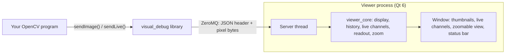

# ID Vision Lab

[](https://github.com/mbuster8/id-vision-lab/actions/workflows/ci.yml)
[](https://github.com/mbuster8/id-vision-lab/actions/workflows/codeql.yml)
[](LICENSE)

A visual debugger for OpenCV, growing into a lab for reading identity documents by camera and by chip.

## The Visual Debug Viewer

An OpenCV program calls one function, and the image appears in the **Visual Debug Viewer**, a separate
window where you can zoom into it, pan around and read the original value of any pixel, whether it is
8-bit, 16-bit, signed or floating point.

```cpp
#include "visual_debug/send_image.h"

visual_debug::sendImage(edges, "Canny edges");   // returns quickly if no viewer is running
```

A camera or video stream goes to a **live channel** instead, which updates in place rather than filling the
history:

```cpp
visual_debug::sendLive(frame, "camera");          // never waits for the viewer to draw
```

An image can also say what its values mean, so a 10-bit picture in 16 bits, or a phone's HDR video, shows
right without typing a display range:

```cpp
visual_debug::sendLive(frame, "phone", {.valueRange = {4100, 60219},
                                        .transfer = visual_debug::Transfer::Hlg,
                                        .primaries = visual_debug::Primaries::Bt2020});
```


### What it does

- **Every image type OpenCV uses**: 8-, 16- and 32-bit, signed or not, floating point, one to four
  channels. The pixel readout always shows the original values, never the 8-bit picture on screen.
- **A history** of thumbnails you can rename, duplicate, delete (with undo), search and sort, kept between
  sessions if you want.
- **Live channels** for cameras and video: the newest frame in place, with its frame rate, frames drawn and
  dropped, and its age; Freeze, Snapshot and Mute; up to eight at once, in a Live group you can make taller.
- **Display range and colours**: Auto, Hold and Fixed ranges, Grey, Turbo and Viridis maps, per image name.
- **HDR video**: HLG and PQ frames tone-mapped for an SDR screen (ITU-R BT.2100, BT.2408), every value still
  readable, and a value-range hint that Auto and Hold use.
- **Show Clipping** marks the pixels at the ends of the range, so glare and crushed shadows stand out at
  any zoom; **region statistics** (Shift-drag) give a rectangle's minimum, maximum, mean and σ per channel.
- **`live_sender`**, a ready-made streamer: a camera, a video file (`.mov`, `.mp4`, `.mkv`, …), a phone's
  HDR video (HLG or PQ) as 16-bit frames with `--hdr`, or a test pattern, in real time.

This started as my bachelor's thesis in 2013, written for Qt 4 and OpenCV 2.4 on Ubuntu. In 2026 I
brought it back: ported to Qt 6 and OpenCV 5, restructured, tested and documented. What changed, and why,
is [below](#what-changed-since-2013). Until October 2026 the repository was called `Image_processing`
([former names](docs/former-names.md)).

## Coming next

- **The Document Lab**, a desktop app for developing document reading: it finds an identity document in a
  camera image, checks capture quality, reads the machine-readable zone (MRZ), and reads the passport's chip
  (ICAO 9303: BAC, PACE, Passive and Active Authentication) through a PC/SC reader.

## How it works



- The **`visual_debug`** library is all a program needs. It depends on OpenCV, ZeroMQ and a header-only
  JSON library, **never Qt**, so it fits into any OpenCV application.
- The **Visual Debug Viewer** is a separate Qt 6 app. If it is not running, a send fails within half a
  second the first time and instantly after that, and the program carries on. Start the viewer later and
  images arrive again.
- The message is a small **JSON header** that describes the image, followed by the **raw pixels**. New
  fields can be added without breaking older viewers. See the [wire format](docs/wire-format.md).
- The viewer listens on **this machine only** unless told otherwise.

## Quick start (macOS)

From a clone of this repository, with [Homebrew](https://brew.sh) installed:

```sh
brew install cmake ninja pkgconf qt opencv zeromq cppzmq nlohmann-json googletest
cmake --preset debug
cmake --build --preset debug
open build/debug/apps/viewer/visual_debug_viewer.app
build/debug/examples/pipeline_demo/pipeline_demo
```

`open` returns before the viewer is ready, so wait until its status bar says
`Listening on [tcp://127.0.0.1:7139]` before running the last command. That command runs an OpenCV pipeline
and sends ten images to the viewer: colour, alpha, greyscale, signed 16-bit, 32- and 64-bit floating
point, a cropped region and 16-bit colour. Hover over them to see the original values.

## Everyday commands

Run these from the repository root. The [build guide](docs/build-guide.md) and the
[user guide](docs/user-guide.md) explain each one in full.

### Configure, build and test

```sh
cmake --preset debug                    # configure; once, or after changing a CMakeLists.txt
cmake --build --preset debug            # build everything into build/debug
ctest --preset debug                    # all 689 tests, about 97 seconds
ctest --preset debug -R ClientServer    # only the tests whose name matches

cmake --preset release                  # an optimised build, into build/release
cmake --build --preset release
ctest --preset release

cmake --preset asan                     # Debug with AddressSanitizer and UndefinedBehaviorSanitizer
cmake --build --preset asan             # into build/asan
ctest --preset asan                     # the same tests under the sanitizers, about 127 seconds
```

### Check before a push

```sh
scripts/check.sh                        # what CI runs: clang-format, debug and asan here, Ubuntu in Docker
scripts/check.sh --quick                # clang-format and debug only, about a minute
scripts/check.sh --linux                # only the CI's Ubuntu job, in Docker
```

It stops at the first failing step and names it, so a push meets no surprises. The Ubuntu job needs Docker
Desktop running. The [build guide](docs/build-guide.md#checking-changes-before-a-push) explains the steps, the
logs and the optional pre-push hook. In Claude Code, the `local-ci` skill runs the check and explains a
failure, and the `pr-ready` skill runs it, reviews the branch and drafts the pull request's description.

### Run the programs

Each preset puts the programs in its own folder: for the release build, write `build/release` where these
commands say `build/debug`.

```sh
# The Visual Debug Viewer. Double-clicking visual_debug_viewer.app in Finder works too.
open build/debug/apps/viewer/visual_debug_viewer.app

# An OpenCV pipeline that sends each of its ten stages; give it a path to use your own image
build/debug/examples/pipeline_demo/pipeline_demo

# The Visual Debug Example Sender: click Open… to pick an image, then Send image
open build/debug/apps/example_sender/visual_debug_example_sender.app

# The smallest sender: three thresholded images
build/debug/examples/minimal_sender/minimal_sender

# Live channels: every example, with what it does
build/debug/examples/live_sender/live_sender --help
```

### Stream cameras, videos and HDR video

`live_sender` sends each frame and its Canny edges as two live channels, named after the source. Quote file
names with spaces in straight quotes.

```sh
L=build/debug/examples/live_sender/live_sender

$L --pattern                                   # a moving test pattern; no camera needed
$L --list-cameras                              # which camera numbers open
$L --camera 0                                  # channels "camera 0" and "camera 0 edges"
$L --camera 1                                  # a second camera beside it, in channels of its own
$L --camera 1 --name phone                     # or named yourself: "phone" and "phone edges"
$L "path/to/My video.mp4"                      # a video file in real time, named after the file
$L --hdr "path/to/iPhone HDR.MOV"              # a phone's HDR (HLG or PQ) video as 16-bit frames
$L --pattern --size 3840x2160 --fps 30         # a 4K load test
```

macOS may first ask to let the terminal use a camera. A file plays in real time: when sending cannot keep
up, frames are skipped and counted; when decoding cannot, the video plays slower. `--hdr` reads the file with
FFmpeg's libraries (Homebrew's OpenCV brings them), and the viewer offers its **HDR** range for the
frames. The [user guide](docs/user-guide.md#running-live_sender) has every option, and the
**[tour of live channels](docs/live-channels-tour.md)** tries every live feature in nine stops, with what to
expect at each: start there.

Senders started before the viewer's status bar says `Listening on [tcp://127.0.0.1:7139]` get
`ViewerUnavailable` and carry on; later sends reach the viewer once it is up.


### In the viewer

The mouse wheel zooms, dragging pans, a double-click fits the image to the window again, and hovering shows
the original value of the pixel under the cursor; Shift-drag draws a region and gives its statistics.
**File → Open…** adds an image file to the history and **File → Save As…** saves the displayed image. The
sidebar's **Live** group lists the live channels (drag the grip below it to show more), and the history
below it renames, duplicates, deletes, searches and sorts. **Range** and **Colours** above the view set how
values map to the screen, **Image → Show Clipping** (⇧⌘K) marks clipped pixels, **Image → Freeze** and
**Snapshot** hold or keep a live frame, the status bar pauses or stops the viewer's server, the activity log
records what arrived and what was refused, and **View → Appearance** picks light or dark. The
[user guide](docs/user-guide.md) covers each of these.

```sh
# A second viewer on another port, and a sender aimed at it
open -n build/debug/apps/viewer/visual_debug_viewer.app --args --endpoint tcp://127.0.0.1:7140
build/debug/examples/pipeline_demo/pipeline_demo --endpoint tcp://127.0.0.1:7140

# Run the viewer in the terminal to see its options, or its log as it runs
build/debug/apps/viewer/visual_debug_viewer.app/Contents/MacOS/visual_debug_viewer --help
```

### Build, test and debug in Qt Creator

1. **File → Open File or Project…** and choose the top-level `CMakeLists.txt`.
2. Tick the **Debug** preset and click **Configure Project**. Qt Creator uses the same `build/debug` folder
   as the command line, so either can build it.
3. **⌘B** builds. Pick `visual_debug_viewer` in the run target selector (the computer icon at the bottom
   left) and press **⌘R** to run it.
4. **Tools → Tests → Run All Tests** runs every test; the results appear in the **Test Results** pane.
   Unlike `ctest`, Qt Creator runs all the tests of one test program in a single process. If one crashes in
   `ImageIO`, see the build guide's [Troubleshooting](docs/build-guide.md#troubleshooting).
5. Click in the margin next to a line to set a breakpoint and press **⌘Y** to debug with LLDB. The first
   time, macOS may ask for your password to let the debugger attach.


## Documentation

| Document | Contents |
|---|---|
| [Tour of live channels](docs/live-channels-tour.md) | Nine stops through live channels, cameras, video files, several senders and HDR video, with what to expect at each |
| [User guide](docs/user-guide.md) | Running each program, `live_sender`'s examples, viewer controls, HDR, clipping and region statistics, configuration, send results, six worked examples |
| [Build guide](docs/build-guide.md) | Installing the tools, presets, targets, running the tests, Qt Creator, troubleshooting |
| [Wire format](docs/wire-format.md) | The message format, validation rules and replies, for writing a sender in any language |
| [Architecture](docs/architecture.md) | Components, dependency rule, threads, transport behaviour, extension points |
| [ADR-001](docs/ADR/ADR-001-technology-stack.md) | Why C++20, Qt 6, ZeroMQ, JSON and GoogleTest |

## What changed since 2013

### The toolchain, then and now

| | 2013 | 2026 |
|---|---|---|
| Platform | Ubuntu | macOS on Apple silicon (Windows and Linux next) |
| UI | Qt 4.8.1 | Qt 6 |
| OpenCV | 2.4, with C-era names such as `CV_LOAD_IMAGE_UNCHANGED` | 5.0, using only API that also exists in 4.x |
| C++ | pre-C++11 style: `0` for null, manual `new` and `delete` | C++20 |
| Build | three qmake `.pro` files with hard-coded build paths | one CMake project with presets, warning-free under `-Wall -Wextra -Wpedantic` |
| Message | a hand-packed binary header | a JSON header plus a pixel frame, validated field by field |
| Streams | none: one still image at a time | live channels from cameras, video files and HDR video (FFmpeg's libraries), in real time |
| Tests | none | 682 GoogleTest tests, plus each test program run whole; also run under AddressSanitizer and UndefinedBehaviorSanitizer |
| Documentation | one paragraph in `readme.txt` | this README, five guides and a decision record |

### Defects found in the 2013 code, and what fixed them

1. **A program froze if no viewer was running**, and every image opened a new ZeroMQ connection. Now one
   connection per client, a reply timeout, a retry back-off and automatic recovery.
2. **The viewer listened on every network interface and trusted the lengths in the header**, so anyone on
   the network could make it read out of bounds. Now loopback only by default, and every field is
   validated before use.
3. **Images with an alpha channel crashed the viewer.**
4. **Multi-channel images deeper than 8 bits crashed it too.** A single display converter now handles
   every depth and channel count.
5. **The pixel readout showed the scaled 8-bit copy**, not the real values, and signed 8-bit images were
   shown as unsigned. It now reads the original.
6. **A cropped region (`image(rect)`) arrived garbled**, because the row stride was not sent. The sender now
   makes such images contiguous first.
7. **The receive thread could only be stopped by killing it.** It now checks a stop flag.
8. **The window could not grow beyond 1366×768.**
9. **The Save action did nothing**: it was defined but never connected. **File → Save As…** now works.
10. **The library depended on Qt** only for an export macro, and its header was copied into the client.
    It is now a Qt-free library with one set of headers.
11. Leftovers: a hard-coded `/home` folder in the file dialog, Symbian and Maemo sections, an unused
    signal. Removed.
12. **Negative cursor coordinates were not checked.** The readout now checks bounds.

### From Slovak to English

Many of the thesis code's names were Slovak. The client lived in `klient/`, the icons in `Obrazky.qrc`
under the prefix `/zakladne` ("basic"), the image label was `lbl_obrazok`, an image's name, width and
height were `nazov`, `sirka` and `vyska`, and every sent image was called `môj obrázok č.1` ("my picture
no. 1"). Now the client is the Visual Debug Example Sender in `apps/example_sender/`, with `resources.qrc`
under `/icons`, `previewLabel`, the JSON fields `name`, `cols` and `rows`, and images named after their
file: `photo.png #1`.

## Project layout

```
id-vision-lab/
├── libs/
│   ├── visual_debug/      the sender library and the viewer's server (no Qt)
│   └── viewer_core/       the viewer's logic: display, history, live channels, pixel readout, zoom (no Qt)
├── apps/
│   ├── viewer/            the Visual Debug Viewer (Qt 6)
│   ├── example_sender/    the Visual Debug Example Sender (Qt 6)
│   └── qt_common/         Qt helpers shared by both apps
├── examples/
│   ├── pipeline_demo/     an OpenCV pipeline that sends every stage
│   ├── minimal_sender/    the smallest use of sendImage()
│   └── live_sender/       streams a camera, a video file, an HDR video or a test pattern as live channels
├── tests/                 GoogleTest tests for all of the above
├── resources/icons/       the apps' icons
├── docs/                  guides, wire format, architecture, decision records
├── cmake/                 warning, sanitizer and macOS icon settings
├── scripts/               check.sh (the CI pipeline, locally), the Ubuntu package list, the pre-push hook
├── docker/                the CI's Ubuntu job as a container
├── .github/               continuous integration, CodeQL and Dependabot
├── .claude/skills/        Claude Code skills: local-ci and pr-ready
├── CMakeLists.txt
├── CMakePresets.json      debug, release and asan builds
├── LICENSE                Apache License 2.0
└── NOTICE
```

## Status

Builds and passes all tests on macOS with Apple silicon. Continuous integration builds and tests every push
on macOS and on Ubuntu 24.04 (with the distribution's OpenCV 4.6, Qt 6.4 and FFmpeg 6.1, the oldest
versions supported). Windows support (vcpkg, presets and a setup script) is the next step; the code is
already written to be portable.

## Licence

Copyright 2013, 2026 Matej Suster. Licensed under the [Apache License, Version 2.0](LICENSE); see also
[NOTICE](NOTICE).
