# ADR-004: Reading documents: detection, quality gates, the MRZ and the scan flow

**Date:** 2026-11-10
**Status:** Accepted

## Context

The Document Lab (ADR-003) now has to read a passport from a camera. The roadmap splits the work in three:

- **A3:** find the data page in each frame, judge whether the frame is good enough (in view, size, flat, sharp,
  no glare, light), tell the user what to change, and flatten the page;
- **A4:** find the machine-readable zone (MRZ) on the flattened page, read it, parse it, and accept one result
  once several frames agree;
- **A5:** read the chip over NFC or a contact reader. A4 only tells the user to place the passport on the reader.

Every piece has to:

- carry an accepted licence, for the code and separately for any model weights: MIT, Apache-2.0, BSD-2-Clause,
  BSD-3-Clause, zlib, ISC or MIT-0. Nothing is used that would need a licence asked for from anyone;
- avoid patented methods;
- build into C++ on macOS, Windows and Linux from Homebrew, vcpkg and Ubuntu 24.04, with `libs/` free of Qt;
- run fully offline. Frames of real passports never leave the machine.

A survey of libraries and local models and a spike on both development machines (an M4 Pro Mac mini and a
Core i9-13900HX Windows laptop) decided it, on 10 November 2026. The test material:

- the owner's three passport clips (1280×720, 1688 frames, every eighth labelled by hand: 148 frames with the
  data page fully in view, 64 with it cut by the frame's edge). No model was trained on them;
- MIDV-2020's 600 photos of mock documents (399 of them passports) and 100 of its passport clips. Both DocsaidLab
  models below were trained on MIDV-2020, so their figures there are optimistic.

Options considered, by concern (measured figures are from that spike):

| Concern | Options | Evaluation |
|---|---|---|
| Inference runtime | ONNX Runtime, CPU execution provider | Runs every candidate model; on the Mac and the laptop alike. MIT; Eigen inside it is MPL-2.0, accepted. |
| | ONNX Runtime with Core ML (macOS) | 2–3 times slower than the CPU for every model measured, 3–5 times the memory, and 0.3–0.9 s to create a session. |
| | ONNX Runtime with OpenVINO (Windows) | Its vcpkg port exhausted the laptop's 32 GB at full parallelism, and took 1 h 24 min at 6 jobs. The provider then aborted at load: ONNX Runtime and OpenVINO's ONNX front end register the same protobuf descriptors in one shared protobuf DLL. |
| | Microsoft's prebuilt ORT packages | Telemetry is on in Microsoft's official builds. vcpkg's and Homebrew's builds leave it off (`onnxruntime_USE_TELEMETRY` defaults to OFF); Homebrew's ran with all network access denied. |
| Document detector | DocsaidLab DocAligner LC100 (heatmaps, 4.77 MB) | Apache-2.0 code and weights. Page within IoU 0.9 in 94.6% of the owner's frames, 98.5% of MIDV's photos, 75.2% of MIDV's clip frames (the best). Returns no page when a corner is off-screen, which suits the "whole page in view" gate. |
| | DocAligner FastViT-T8 | 95.9% / 98.5% / 73.7% and faster, but its backbone carries Apple's own licence, which is not on the list. |
| | A classical line detector (spike prototype) | 95.3% on the owner's clips, but 61.8% and 50.8% on MIDV. |
| | Apple Vision | macOS only; 91.9% / 70.7% / 68.6%. |
| | A2's contour detector | 19.6% on the owner's clips. |
| MRZ reader (on the flattened page) | DocsaidLab MRZScanner, detection and recognition (30 + 41 MB) | Apache-2.0. All 148 of the owner's frames read exactly, none wrong with valid check digits; 160 ms per read on the Mac, 191 ms on the laptop. Accepted the right MRZ in 78 of MIDV's 100 clips, never a wrong one. |
| | PP-OCRv6 small recognition (21 MB) | Apache-2.0. 83.8% exact, 2 frames wrong with valid check digits, 41 / 46 ms. Accepted right in 69 clips, never wrong. |
| | Tesseract with Doubango's `mrz` model | 81.8% exact; brings Leptonica and no gain. |
| | PP-OCRv5 English, PP-OCRv6 tiny | 71.6% and 31.8% exact; tiny accepted one wrong MRZ. |
| | Apple Vision | macOS only; 15.5% exact. |
| Agreement across frames | Per-character voting with frame and character weights, or stopping on an estimated next result | Claimed by US 11,640,720 and US 11,816,910. |
| | The same whole MRZ, every check digit valid, in M of the last K frames | No alignment, no weights, no estimate. At 3 of 10 it accepted the right MRZ in all three of the owner's clips and never a wrong one on either machine. |
| Correcting OCR confusions | Field-aware: letters to digits in dates, numbers and check digits; digits to letters in codes and names | Without it, 3 of 10 accepted wrong MRZs in MIDV's clips (5 for MRZScanner, 24 for PP-OCRv6 small); with it, none. |
| Local vision-language models | Small VLMs through llama.cpp (several are Apache-2.0 or MIT) | None reads an MRZ per frame in tens of milliseconds or returns a document's corners, and no published evaluation of one on MRZ reading was found. At best a second reader on a still; not needed for A3 or A4. |

## Decision

### Technology

1. **The licence rule above is the project's rule** for code and weights alike. MIDV-2020 is used for evaluation
   only, on the developer's machine, and never committed or used to train weights we publish (CC BY-SA's
   ShareAlike, and the non-commercial terms of its generated faces). Weights we train come from our own
   recordings, documents we render ourselves, or data under an accepted licence.
2. **ONNX Runtime with its CPU execution provider** runs every model: from Homebrew on macOS and from vcpkg on
   Windows and Linux (CI's Ubuntu job too). Never Microsoft's prebuilt packages. Core ML and OpenVINO are not
   used; either may come back only with a measurement that justifies it. On Windows, the code initialises ORT's
   API by hand and checks its version: Windows 11 ships its own older `onnxruntime.dll` in System32 (1.17 on the
   project's laptop), which the loader would otherwise take when vcpkg's copy is not beside the program.
3. **Model files are fetched at configure time**, each from a pinned release URL and checked against its
   SHA-256, into a cache a CMake variable can point at a local copy, so builds work offline. Each file's licence
   travels with it into the packages.
4. **A3's detector is DocAligner LC100 alone.** FastViT-T8 takes the same input and stays a drop-in to measure
   again if its backbone's licence is ever accepted.
5. **Flattening is a homography** from the four corners to the document's ICAO aspect (TD3 passports
   125 × 88 mm).
6. **The quality gates are classical image measures**, Qt-free and unit-tested: in view (not cut by the frame's
   edge), size (too far, too close), flat (tilt), sharp, glare and light (too dark, too bright). Their thresholds
   are set on the owner's labelled clips.
7. **A4's reader is MRZScanner** on the flattened page, run on a cadence (a few reads a second, on frames that
   pass the gates). PP-OCRv6 small is the measured fallback.
8. **The MRZ parser is ours** (ICAO Doc 9303's TD1, TD2 and TD3), with field-aware correction; a read counts only
   when every check digit passes.
9. **Agreement is whole-MRZ, M of the last K frames** (3 of 10 to start), reset for a new document. No
   per-character combination, weights or estimated results.
10. **Faces come in A3.2**, with libfacedetection (BSD-3-Clause, its weights compiled in).
11. **Not used:** Apple Vision as an engine, Tesseract, VLMs and LLMs.

### The scan flow

The screens below were agreed with the owner and are built as drawn. They show the canvas, the results panel
and the cards; the window's own rows of controls stay as ADR-003 built them.

12. **The scan starts with the camera.** With the Document processor chosen and a camera running, guidance shows
    from the first frame: "Show the passport's photo page". With no camera connected, the canvas says so and
    offers a video file instead; with camera access refused, it says where to allow it. Each goes once a
    camera appears, or once access is allowed and the camera starts.
13. **One big banner at a time**, top centre over the canvas, on a dark panel that keeps it readable over any
    frame: a large bold line with its symbol and a smaller line under it. Red with ✗ means do something; green
    with ✓ means good, hold still; white is neutral. The page's outline is drawn red or green to match. Gate
    chips along the bottom show every gate at once (✓ or ✗); the results panel shows the numbers.

    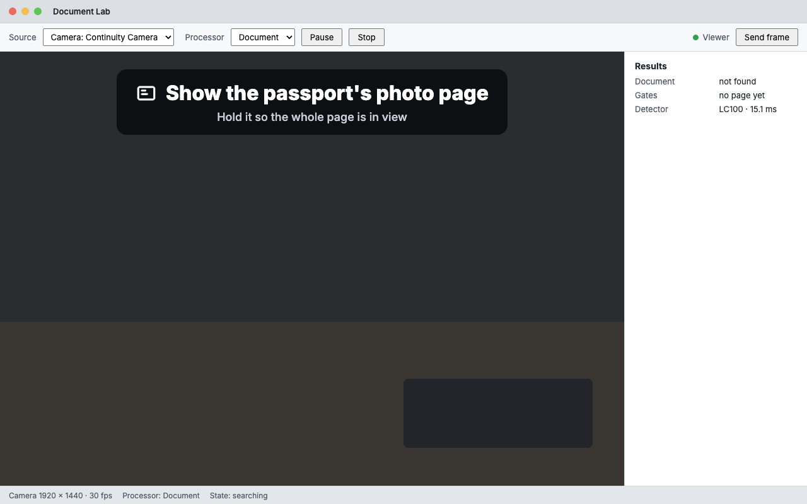

    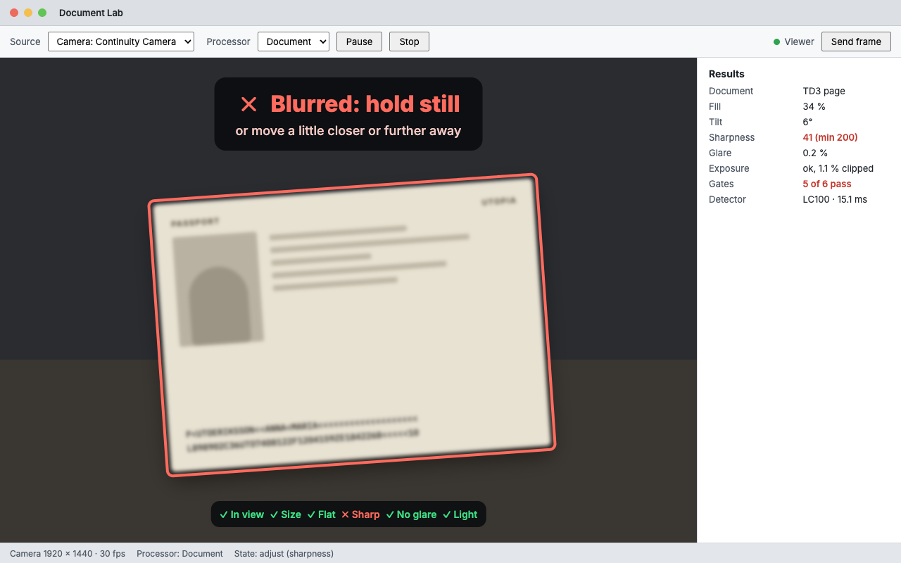

14. **The hints, first that applies wins**, checked on every frame:

    | # | When | Banner (big line · smaller line) | Step |
    |---|---|---|---|
    | 1 | No page found | Show the passport's photo page · Hold it so the whole page is in view | A3 |
    | 2 | Cut by the frame's edge | ✗ Move back · the whole page must be in view | A3 |
    | 2b | Cut by the frame's edge, but small enough to fit | ✗ Move the page to the middle · the whole page must be in view | A3 |
    | 3 | Too far | ✗ Move closer | A3 |
    | 4 | Too close | ✗ Move a little further away | A3 |
    | 5 | Tilted | ✗ Hold the page flat to the camera | A3 |
    | 6 | Blurred | ✗ Blurred: hold still · or move a little closer or further away | A3 |
    | 7 | Glare | ✗ Glare on the page · tilt it slightly away from the light | A3 |
    | 8 | Too dark | ✗ Too dark · add more light | A3 |
    | 9 | Too bright | ✗ Too bright · move out of direct light | A3 |
    | 10 | Every gate passes | ✓ Good: hold still (A4 adds "Reading the lines at the bottom · 2 of 3") | A3, A4 |
    | 11 | Gates pass, no MRZ band | ✗ Keep your fingers off the two lines at the bottom | A4 |
    | 12 | Gates pass, no accept after 5 s | ✗ Can't read the lines at the bottom · check for glare or a finger on them | A4 |

    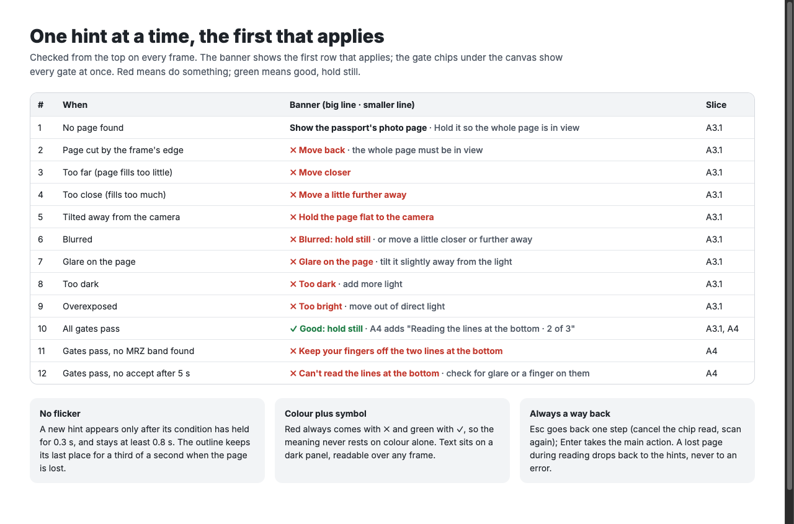

15. **No flicker, and bad news fast.**
    - **Good:** "Good: hold still" shows once every gate has passed for 0.5 s, and gives way to a problem that has
      held for 0.1 s.
    - **Other hints:** each shows once its condition has held for 0.3 s, and stays at least 0.8 s.
    - **Gates** have hysteresis, and a page lost for less than a third of a second keeps its last verdicts and its
      outline.
    - **Why:** measured on the owner's clips against equal 0.3 s and 0.8 s timings for every hint, this showed
      "Good" on fewer frames with the page cut or blurred, and switched less often.
16. **Hold still, with progress (A4).** While the MRZ is read, the band is outlined dashed green and the banner
    counts agreeing reads, "2 of 3", with a three-part bar.

    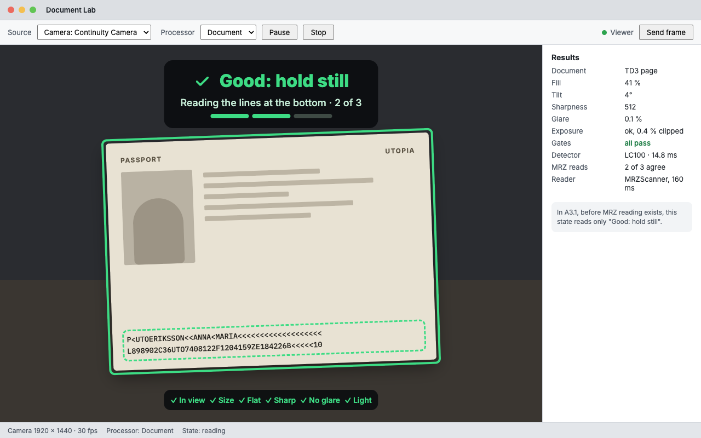

17. **Scanned, then the chip (A4, then A5).** When the MRZ is accepted the frame is captured and kept in memory,
    and a card says at once that the passport is scanned and to place it on the chip reader. Until A5 the
    reader line reads "Chip reading arrives in A5", and the card offers only Skip the chip and Scan again. A5's
    screen shows the read's steps and progress, a hint if contact is lost, and Cancel.

    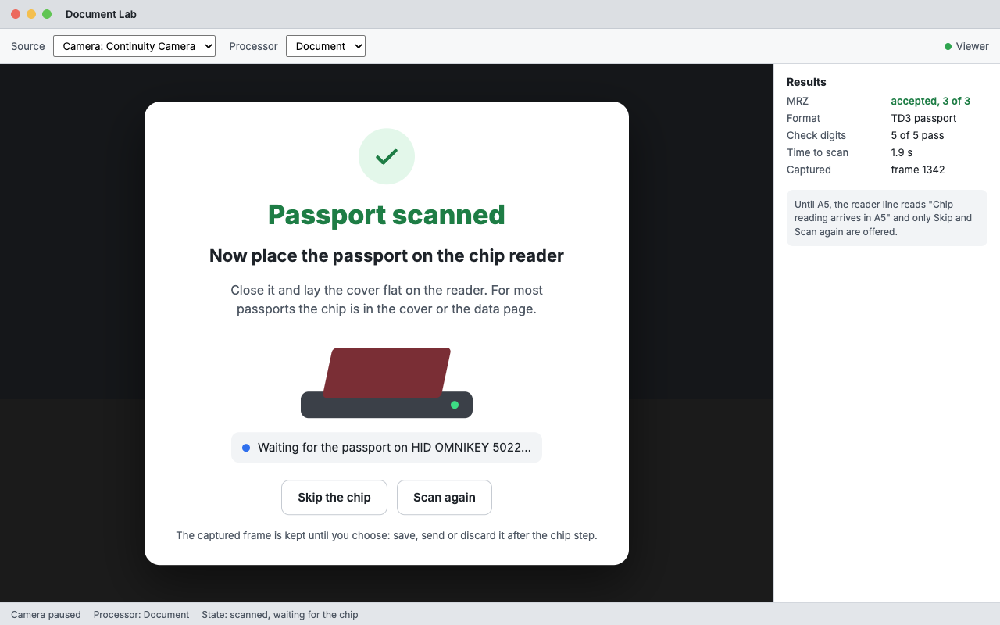

    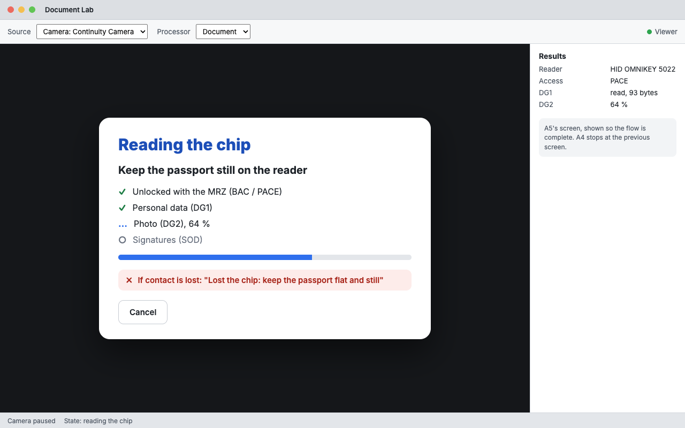

18. **Review after the chip, or after it is skipped or cancelled.** The captured frame, with overlays to switch
    on and off (document outline, MRZ band, corner numbers, gate values; the photo zone from A3.2), the MRZ's
    fields with their check digits, a warning if the document has expired (the scan itself still succeeds), and
    Save to captures, Send to the viewer, Discard and Scan another.

    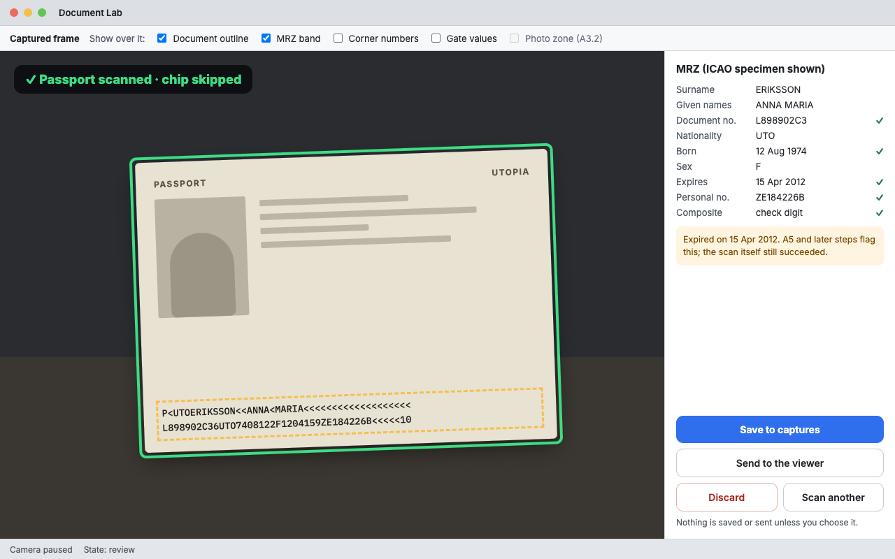

19. **Nothing is automatic beyond the capture.** Nothing is saved or sent unless the user chooses it.
20. **Always a way back.** Esc goes back one step (cancel the chip read; scan again); Enter takes the screen's
    main action where it has one. A page lost while the MRZ is read drops back to the hints, never to an error.
21. **Colour always comes with a symbol**, and all text meets a contrast of 4.5:1 against its background in the
    light and the dark appearance. The banner and chips are the same in both, on their dark panel at 85% opacity;
    the cards and the panel follow the system's appearance:

    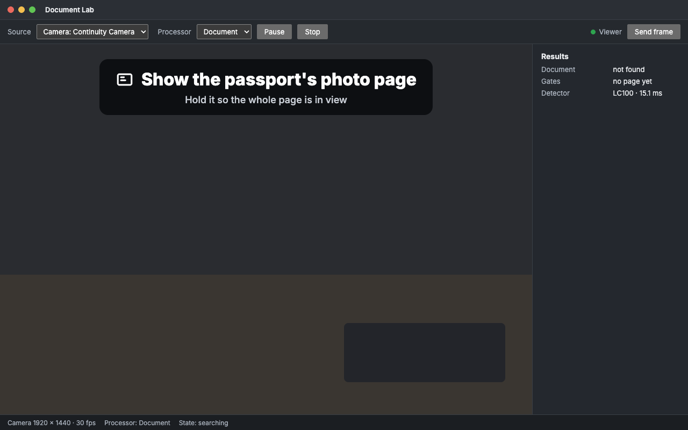

    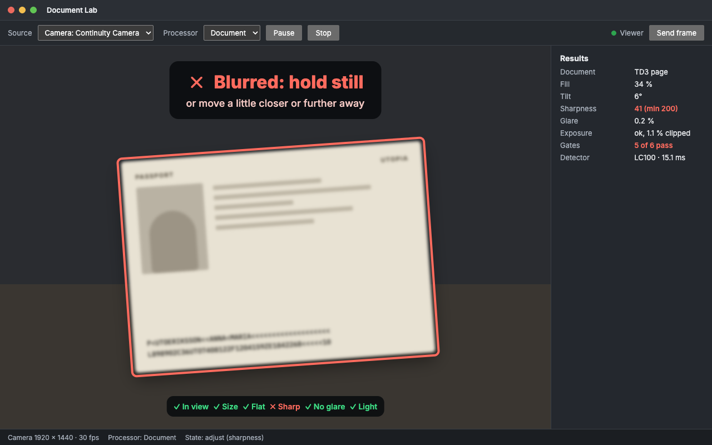

    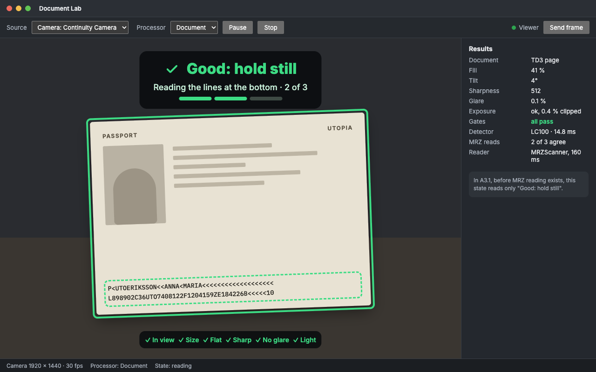

    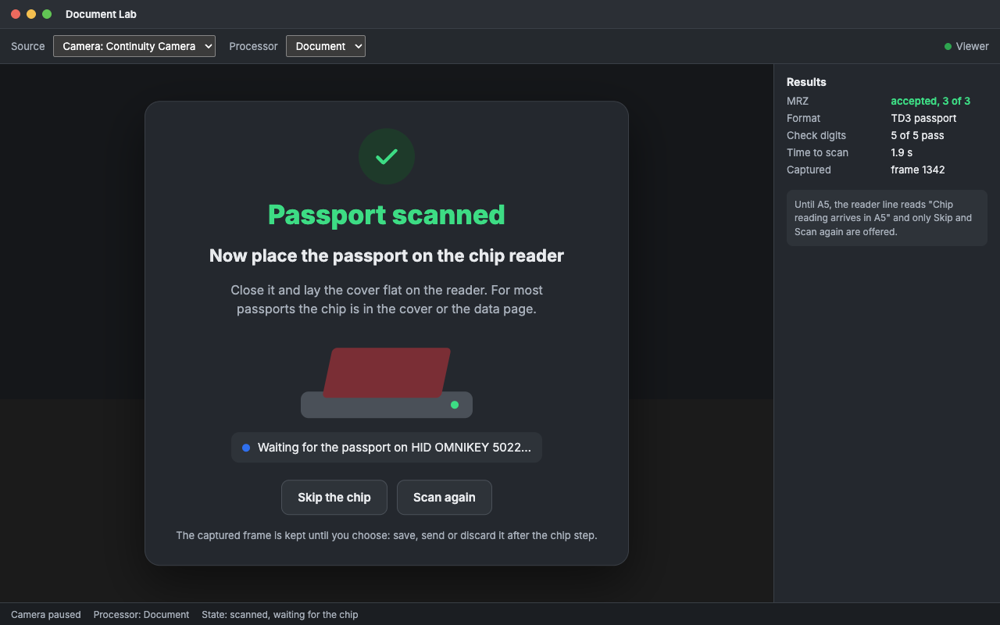

    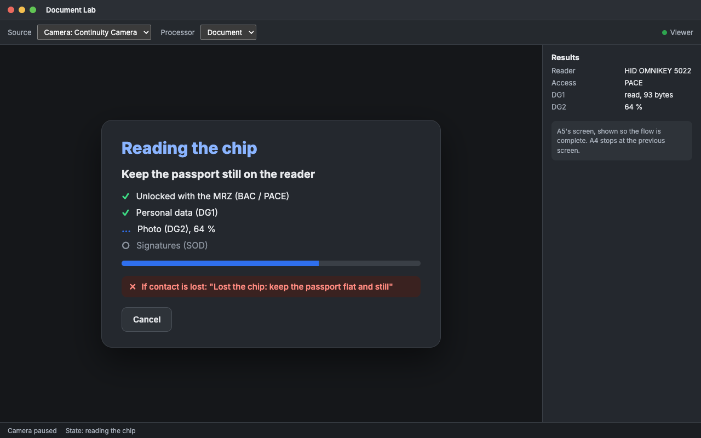

    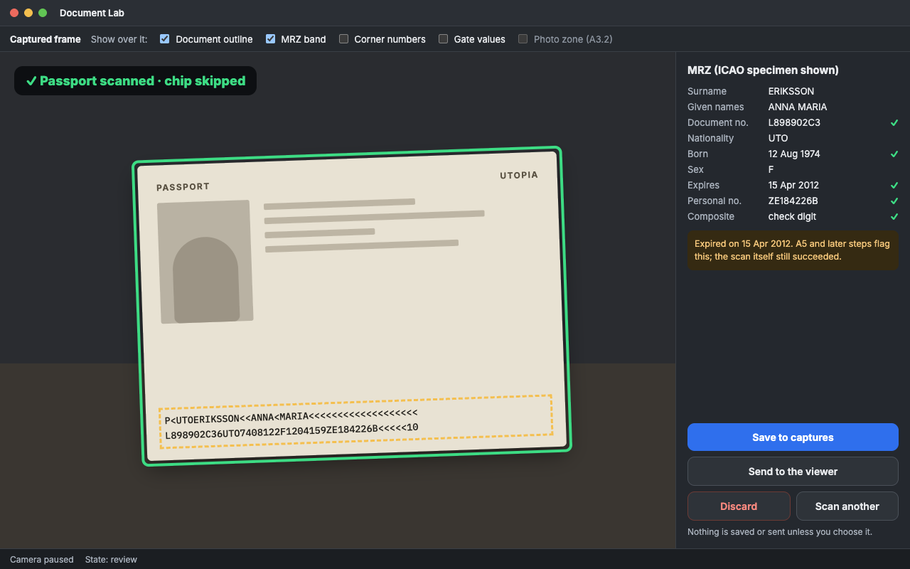

## Consequences

- Positive: one runtime and two small model families cover A3 and A4 on all three platforms, every licence
  checked at source, nothing asked of anyone.
- Positive: the MRZ needs three exact, check-digit-valid reads to be accepted, so a wrong accept needs the same
  wrong read three times with every check digit passing.
- Positive: the flow tells the user one thing at a time, in words, and keeps the captured frame until they decide.
- Negative: a first build fetches about 75 MB of models (LC100 4.77 MB, MRZScanner 30 + 41 MB), and needs the
  network unless a local copy is given.
- Negative: vcpkg builds ONNX Runtime from source: about 15 minutes on the Windows laptop the first time with
  the dependencies this project did not already have, and in CI until its cache holds it.
- Negative: MRZScanner costs 160–190 ms a read on these machines, so it runs a few times a second rather than on
  every frame.
- Negative: both DocsaidLab models were trained partly on MIDV-2020; that data keeps its own terms, as it does for
  any user of the models.

## Links

- `docs/ADR/ADR-003-document-lab-media.md`: the Document Lab's media stack, processors and engine.
- `docs/architecture.md`: the components, the threads and the engine.
- `docs/user-guide.md`: running the Document Lab.
- `docs/images/scan-flow/`: the screens above.
