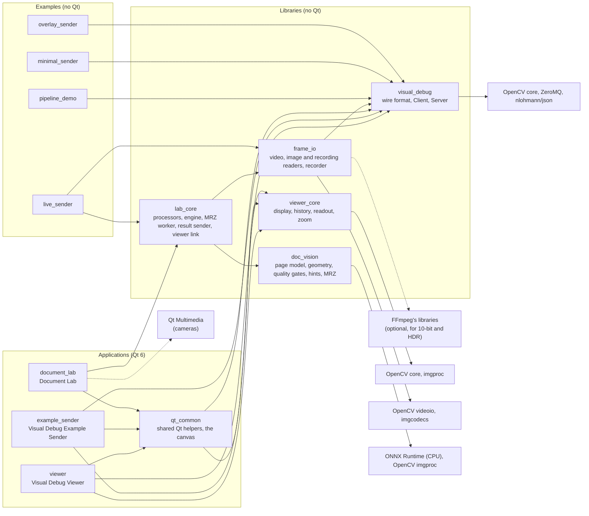
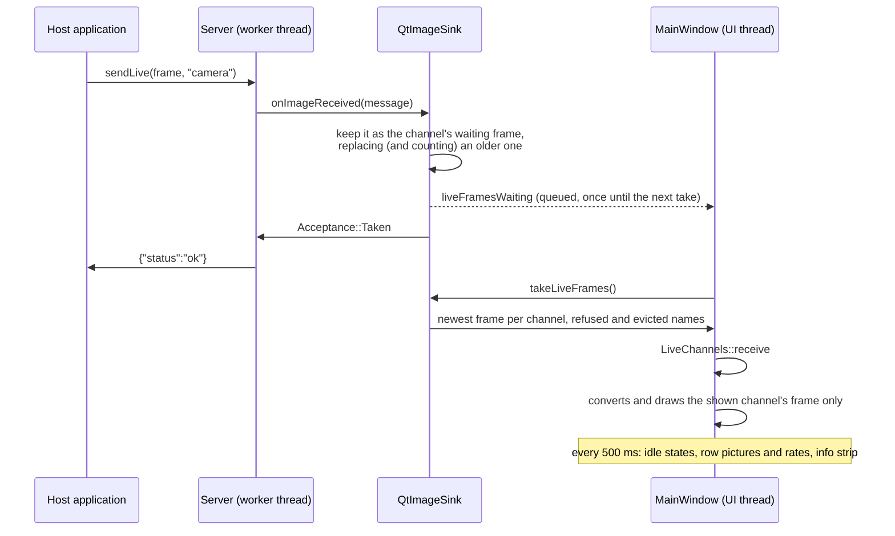

# Architecture

How the parts fit together, which way dependencies point, what runs on which thread, and where to extend
it. For the message format itself, see [`wire-format.md`](wire-format.md); for the reasons behind the
technology choices, see [ADR-001](ADR/ADR-001-technology-stack.md).

## The idea

An OpenCV program calls one function to show an image in a separate viewer process. The program takes on
only OpenCV, ZeroMQ and a header-only JSON library, never the viewer's UI toolkit. If no viewer is
running, the call returns quickly and the program carries on.

## Components



| Component | Responsibility |
|---|---|
| `libs/visual_debug` | Everything both ends of the channel share. `wire_format`: encodes an image into the two frames and decodes them back, validating everything and never throwing. `ImageDescription`: what a sender may say about an image beyond its pixels (its value range, a video's transfer and primaries, and its overlays: the `Polygon`, `Rectangle`, `Circle` and `Point` shapes of `overlay.h`), an optional extra argument of every send. `ImageSender`: the interface a host application depends on. `Client`: its ZeroMQ implementation. `sendImage()` and `sendLive()`: the one-line convenience calls, using one process-wide `Client`. `Server`: the viewer's receive loop on its own thread. `ImageSink`: the interface through which the server hands images to whoever displays them. `endpoint`: the default endpoint and the loopback check. |
| `libs/viewer_core` | The viewer's logic, free of any UI toolkit, so it is unit-tested without Qt. `toDisplayImage`: any supported image to 8-bit RGBA, with a display range and colour map, at full size or at the size it is drawn (`sizeWithin`), with clipping marks if asked. `ImageTags`: an image's description as the viewer keeps it, its overlays (viewer_core's own copies of the shapes, in `overlay.h`) as one shared, unchanging list so that copying tags for every frame and draw copies a pointer, and `defaultSettings`, which makes HDR the default range for HLG and PQ. `toneMapToSdr`: the HDR range, HLG or PQ signal to sRGB; `toDisplayImage` takes HDR's black and white from the settings' range when it is set (`hdrBlackAndWhite`, dragged on the histogram), else from the sender. `regionStatistics`: per channel, the minimum, maximum, mean and standard deviation of a rectangle's values. `valueExtent`, `rangeMarkers` and `histogramOf` (in `histogram.h`): the whole image's finite extent and non-finite count, the range in use as markers, and per-channel counts across an axis spanning both, on an even grid of samples above `kHistogramSamples`; with the drag arithmetic, `axisFraction`, `axisValue`, `draggedRange` and `settingsForDrag`. `DisplaySettings` and `DisplaySettingsStore`: those choices, by name, for the session. `ImageHistory`: the bounded list of received images. `LiveChannels`: per live channel, the frame to show, its counters and rates, and whether it is idle or frozen; `kIdleAfter`, the one idle time for the window and the sink. `inspectPixel`: the readout text for one pixel of the original. `Viewport`: zoom and pan arithmetic. |
| `libs/frame_io` | Frames from files and to disk, for the Document Lab and `live_sender`, free of Qt. `Frame`: an image (8- or 16-bit), its number, its time and its tags. `ReplaySource`: frames in order, with their rate, from `openVideo` (FFmpeg's libraries through `FfmpegVideo` for every video they open, an 8-bit SDR one as 8-bit frames and anything deeper or HLG and PQ as 16-bit, on the hardware decoder where there is one, except H.264 on macOS, measured faster in software (`codecPrefersSoftware`); OpenCV's videoio, AVFoundation first on macOS and kept only when it reads a first frame, for the rest), `openImageFolder` and `openImageFile` (imgcodecs, natural name order), `openRecording`, and `openReplay`, which tells them apart; each reads ahead on a thread of its own and wakes its caller when a frame is ready. Folders, recordings and a video whose frames carry times can seek: `FfmpegVideo::seek` goes to the keyframe before the time and decodes forward to the exact frame, on the read-ahead thread, and a newer seek, a restart or the source's end abandons one in progress between frames. `ReadAhead`: that reading thread. `ReplayPacer`: when each frame of a replay is due, never skipping one. `yuvToBgr` and `p010ToBgr16`: a camera's planes to BGR by matrix (BT.601, BT.709, BT.2020) and range. `RecordingWriter`: a recording as a folder of PNGs and a `recording.json`, written by six threads from a queue bounded in bytes; `writeCapture`: one frame and its findings. |
| `libs/doc_vision` | Document vision, free of Qt, on ONNX Runtime. `OnnxModel`: a model on ORT's CPU execution provider, initialised by hand (`ORT_API_MANUAL_INIT`) so a runtime older than the one built against is an error value, not a crash (a missing one stops the program from starting, as it is linked); ORT's headers appear only in its `.cpp` files. `PageDetector`: DocAligner LC100, four corner heatmaps from a 256 × 256 frame, their blobs' centres mapped back to the frame (`cornersFromHeatmaps`), behind the `PageFinder` interface the tests script; `toBgr8`, any frame (16-bit by its value range) as 8-bit BGR. `page_geometry`: the `Quad` in a stable corner order (`orderedCorners`, `alignTo`), the TD3 page flattened, and the shares and the tilt the gates judge. `quality_gates`: `measure` and `GateJudge`, the six gates with hysteresis. `guidance`: `hintFor`, and `HintTimer`, `ChipTimer` and `PageHold`, which steady the hint, the chips and a briefly lost page by the frames' own times. A4's MRZ: `mrz` parses ICAO 9303's TD1, TD2 and TD3 with field-aware correction and the check digits (`parseMrz`, `Mrz::valid`, the dates by a given today); `mrz_agreement` accepts a whole MRZ read identically on 3 of the last 10 frames, one read a frame, with no per-character voting; `mrz_reader`'s `MrzScanner` (DocsaidLab MRZScanner's two models) finds the band on the flattened page and reads its lines, behind the `MrzReader` interface the tests script, and `readUpright` reads a page the other way up when its band is near the top. |
| `libs/lab_core` | The Document Lab's processing, free of Qt. `FrameProcessor`: the hook for vision code, and `makeProcessor` for None, Edges, Outline (`edgesOf`, `documentOutline` and `OutlineHold`, which `live_sender` uses too) and Document. `DocumentProcessor`: `doc_vision`'s page finder, gates and timers on each frame, opening the model lazily, once per run, its results carrying `Guidance` (the frame's and the shown hint, the chips, which overlay is the outline, and whether the model was unavailable) and structured findings (`Finding`: a name, a value and a tone). With a reader (A4) it hands each gate-passing fresh page to its `MrzWorker`, collects the read at the next frame, keeps the agreement window (cleared after a second without a fresh page), shows hints 11 and 12, maps the last band through this frame's quad, and from an accept on carries the `MrzScan` (the sharpest agreeing frame, its quad and band, its gate rows and the MRZ) on every result until `reset()`; no finding or overlay label ever holds MRZ text. `Engine`: moves a source's frames through the processor to the window's slot, the recorder and the sender on one processing thread, with commands posted to a mailbox, a generation per run, and seeks asked for faster than they are done added up into one. `ResultSender`: a result to the viewer as live channels, on a thread of its own, newest first; paused, it drops what it is given, and stopped, it ends the channels it sent on. `ViewerLink`: the lab's own connection to the viewer beside the stream's, on a thread of its own, which pings it and sends single frames into its history, numbered, saying when each ended (answered, refused, or dropped by a new address). `MrzWorker` (A4): the reader's thread, a slot of one job (the page and its frame's record), the reader opened lazily there, a read in progress cancelled and the thread joined when it goes; `Engine::resetProcessor` resets the processor without starting a new run. `FocusController` (A3.3, [ADR-005](ADR/ADR-005-camera-focus.md)): a camera run's focus, fed the Document processor's `PageFacts` after each frame; it searches a `FocusControl` (the camera's own focus, behind an interface) for the position where the page or a clicked region is sharpest, holds it, says when a camera cannot make the page sharp, and puts back what it found; timed by the frames' own times. |
| `apps/qt_common` | The Qt code the apps share. The canvas: `ImageView` (one image or live frame: zoom, pan, overlays, pixel readout, Shift-drag regions where the app allows them), `LiveConverter` (a live frame's picture made on a thread of its own, newest first), `live_drawing` (what part of a frame to convert, and at what size, and whether a zoom or pan needs another picture), `image_tags_conversion` (visual_debug's descriptions to viewer_core's tags) and `private_files` (folders and files only their owner may read). And: `toQImage` (an RGBA `cv::Mat` to a `QImage`), choosing and reading an image file, `application_identity` (the apps' names and descriptions; `setApplicationIdentity`, which names what `QSettings` and the standard paths use), `about` (Help → About, which names the OpenCV and Qt versions the app runs with), `appearance` (the shared System, Light or Dark setting and its menu), `outline_icons` (the line icons, drawn in the palette's colours), `controls` (the shared control height, framed buttons and the regular font), `overlay_painter` (`paintOverlays`: overlays in image pixels drawn through an image-to-widget transform, with the see-through fill, the solid edge and the label tab, at a fixed size on screen, or, for a `Guide` polygon, a thick line on a dark halo with no fill or tab) and `shades` (the panel, hover, selection and divider greys, blended from the palette's window and text colours; `usePanelGrey`, which keeps a widget on the panel grey as the appearance changes; and `DividerLine`). |
| `apps/viewer` | The Visual Debug Viewer. `MainWindow` composes the parts; `qt_common`'s `ImageView` paints through a `Viewport`, and draws each picture's overlays above it (they come with the picture in `setImage`, so a picture never shows another's); `ImageSidebar` holds the search field, the sort options and `ThumbnailPanel`, which shows the history: a list view over `ThumbnailModel` (the history's rows, in history order), seen through `ThumbnailFilterModel` (the names the search matches, in the chosen sort) and drawn by `ThumbnailDelegate`, and `LiveChannelPanel`, the Live group's rows with their mute and close buttons and right-click menu, and a grip below them that sets how many rows show (`paintDivider` draws it as the splitters' handles) (the sidebar steps ↑ and ↓ across the live rows and the thumbnails as one list); `ImageInfoBar` is the strip above the view, with the overlays button, `DisplaySettingsControl` (the Range and Colours buttons) and Freeze and Snapshot; `QtImageSink` moves images and live frames from the server thread to the UI thread; `ActivityLog` is the activity log (a list model, stored in the endpoint's `DataFolder`) and `ActivityLogPanel` shows it; `DividerSplitter` is a splitter whose handles draw a divider line and a grip; `ImageStore` keeps images in files, `StorageWorker` drives it on its own thread, and `StorageController` owns that thread and the restore for the window. |
| `apps/example_sender` | The Visual Debug Example Sender, which shows how a Qt app uses the library. Its window takes a factory that makes an `ImageSender` for an endpoint, so it never knows which transport is behind it, and a new endpoint in its **Send to** field gets a new sender. |
| `apps/document_lab` | The Document Lab. `LabWindow` runs a camera or a replay through the engine and draws the result on the shared canvas with the viewer's glue, Show picking the frame or a processor's picture; it records, captures, seeks in a replay, streams to a viewer (▶ ⏸ ■) and sends it single frames, with the viewer's availability beside its address. `CameraBackend` is the cameras behind an interface (`makeQtCameraBackend`: Qt Multimedia, a new `QCamera`, capture session and `QVideoSink` per start, numbered so a late frame of an earlier start is dropped); `toFrame` converts a `QVideoFrame` by its own pixel format, upright and unmirrored; `camera_formats` lists a camera's formats once each and picks the default; `LabDependencies` lets tests replace cameras, threads, dialogs, the clock and the model folder (`defaultModelFolder`: the bundle's `Resources/models`, else `models` beside the program). For the Document processor, `ScanBanner` and `GateChips` sit over the canvas, transparent to the mouse, fed from the guidance of the result whose picture is on screen, or the window's own state while nothing runs (`scan_words` holds their words, `scan_style` their colours); the outline goes to the canvas as a `Polygon` of `Style::Guide`, set in the picture's own job so the two arrive together. `camera_focus` makes a camera run's `FocusControl` from Qt's camera id: UVC requests through IOKit on macOS (`uvc_descriptor` reads the camera terminal from the device's descriptor bytes, bounds-checked), DirectShow's `IAMCameraControl` on Windows, none elsewhere; a click on the canvas (`ImageView::clicked`, sent once the double-click interval has passed) or F becomes the engine's `focusAt`, and the banner, chips and outline follow the result's `FocusStatus` (ADR-004 item 14: "focusing" over every hint but the first). A4's scan flow (`scan_flow`, without widgets): a result carrying a new scan shows `ScannedCard` over the dimmed frame and pauses the camera (frames no longer handed on, the session open) or a playing replay; Skip the chip opens Review (`review_view`: `ReviewBar` above the canvas, `ReviewPanel` in the results' place, the pill and `GateValuesBox` over the canvas), whose Save writes a capture with an `mrz` section and Send sends a still through the link; Scan again, Discard and Scan another reset the processor and let frames come again. `media_smoke` checks that Qt Multimedia's backend loads beside frame_io's readers. |
| `examples/pipeline_demo` | An ordinary OpenCV program that sends each stage of a pipeline. Its stages are a separate `pipeline` library so tests can check them. |
| `examples/minimal_sender` | The smallest use of `sendImage`, compiled so the user guide's first example cannot go stale. |
| `examples/overlay_sender` | An image sent with overlays, compiled so the user guide's overlay example cannot go stale. |
| `examples/live_sender` | Streams a camera, a video file or a test pattern to live channels with `sendLive`, with an edge channel beside it. Everything but the reading of cameras and files is a separate `live_sender_lib`, so tests check it without a camera: the arguments, the pattern, and `RealTimeFrames` (when each frame is due, and which are too late to send). Video files are read through `frame_io` (`openVideoFile`, `ReadAhead`, and `FfmpegVideo` for `--hdr`, built only when CMake finds FFmpeg's development files); the edges and the document outline are `lab_core`'s. |

## The dependency rule

Dependencies point one way: applications and examples depend on the libraries, never the reverse.

- **No library includes a Qt header or links Qt.** A host application embedding `visual_debug` must
  not inherit Qt, which is large and could clash with its own Qt version; `frame_io`, `doc_vision` and
  `lab_core` stay free of it so the processing and its tests run without it.
- `visual_debug` and `viewer_core` do not depend on each other. `lab_core` depends on `doc_vision` and on
  `frame_io`, which depends on `visual_debug` (for the tags); none of them depends on `viewer_core`, and
  `doc_vision` on no other project library.
- Only `doc_vision` uses ONNX Runtime, and only in its `.cpp` files. It is built from source everywhere
  (Homebrew, vcpkg), never Microsoft's binaries, and its models are fetched at configure time, checked
  against a pinned SHA-256 and cached, never committed.
- Only `qt_common` and the apps may use Qt, and only the Document Lab Qt Multimedia.
- Only `frame_io` (`FfmpegVideo`, when CMake finds FFmpeg) and its tests use FFmpeg's libraries directly.

CMake enforces this: each library's `CMakeLists.txt` links only OpenCV, ZeroMQ, nlohmann/json and, for
`doc_vision`, ONNX Runtime;
`qt_standard_project_setup()` and automatic `moc`, `uic` and `rcc` are switched on in `apps/CMakeLists.txt`
only; and configuring with `-DID_VISION_LAB_BUILD_QT_APPS=OFF` never looks for Qt, yet builds the five
libraries, the examples and their tests. Library code that uses Qt fails to link in that build. A bare
Qt `#include` may still compile, because Homebrew puts Qt's headers in the same shared include folder as
ZeroMQ's, so code review has to catch those.

## One image, end to end

```mermaid
sequenceDiagram
    participant Host as Host application
    participant Client as visual_debug::Client
    participant Server as Server (worker thread)
    participant Sink as QtImageSink
    participant UI as MainWindow (UI thread)

    Host->>Client: sendImage(mat, "Sobel X")
    Client->>Client: encode: JSON header + pixel bytes<br/>(copies a non-continuous Mat first)
    Client->>Server: ZeroMQ multipart message (REQ)
    Server->>Server: decode and validate
    Server->>Sink: onImageReceived(message)
    Sink-->>UI: imageReceived signal (queued)
    Sink->>Server: true (accepted)
    Server->>Client: {"status":"ok"} (REP)
    Client->>Host: SendResult::Delivered
    UI->>UI: ImageHistory::add (display conversion)
    UI->>UI: ThumbnailPanel::addImage; selects it if listed
    UI->>UI: ImageView shows it fitted (if selected)
    UI->>Sink: markHandled()
```

The reply goes back as soon as the sink accepts the image, before the UI has drawn it, so a sender never
waits for painting.

**An image's description.** An `ImageDescription` passed to a send travels as the optional header fields
`valueRange`, `transfer`, `primaries` and `overlays`; the decoder refuses invalid ones with reasons of their own and
leaves absent ones absent. The viewer turns it into `viewer_core::ImageTags` (`image_tags_conversion`) as the
image arrives, and the tags go wherever the image goes: its `ImageOrigin` in the history, a live channel's
shown frame, duplicates and snapshots, and the header `ImageStore` writes for an image kept between sessions
(an image stored before tags existed loads untagged; one whose header no longer fits 64 KiB under a longer
name is stored with as many of its overlays as fit). The info strip names them (`tagsText` in
`display_text`). Every picture `MainWindow` hands the view goes through `showPicture`, which passes the shown
tags' overlays with it and sets the info strip's overlay count, so a live frame always shows its own.

## One live frame, end to end

A frame sent with `sendLive(frame, "camera")` carries `live: true` and the sender's clock as `sentAt`
([wire format](wire-format.md#header-fields)). It never enters the history: it updates its channel in place.



**The sink never makes a live sender wait.** Live frames do not use the eight slots or the 200 ms wait:
each channel keeps only its newest waiting frame, so a sender faster than the screen loses frames in the
viewer (counted as dropped), never time, and the sink holds at most one waiting frame per channel. It opens
at most 8 channels and refuses any frame, of a new channel or an open one, that would take the open
channels' newest frames past 1 GiB; a channel without a frame for `viewer_core::kIdleAfter` (3 s) is idle,
and the longest-idle one is closed to make room, never the frame's own channel and never the one in view,
which the window names with `protectLiveChannel`. The window marks a channel idle after the same constant,
at its next 500 ms tick, so a row reads `idle` from about when the sink may close that channel, if it is not
the one in view. A refused frame is answered `too many live channels`. The UI logs each refused name once,
for up to 8 names; a sender that numbers its channel names would otherwise cost the log a line per frame, so
refusals beyond those are counted with the rejections.

**The UI does the least it can per frame.** `takeLiveFrames` hands every channel's newest frame to
`LiveChannels`, but only the channel in view is converted and drawn, wrapped in a `QImage` without a copy
(`qt_common::wrapAsQImage`), and the view keeps its zoom and pan while the frame size stays the same. The
frame is converted at the size it will be drawn: `ImageView::deviceScaleFor` gives the device pixels per
image pixel for the coming draw, and below 1 `toDisplayImage` maps the values to 8 bits at full size, shrinks
that to the drawn size, and only then makes it RGBA or colour-maps it, so a NaN stays one dark pixel among its
neighbours. The shrink is an exact whole-number `INTER_AREA` step, with a factor of its own across and down
(from a crop to a multiple of each), followed by `INTER_LINEAR` for the rest, as `INTER_AREA` at a fractional
factor is far slower. Zoomed in, only the part of the frame in view is converted, with a quarter of the
visible width and height on each side (`MainWindow::liveDrawing`), or the whole frame when that part would be
three quarters of it or more. Under Auto, and HDR shown as Auto, the part is given the whole frame's range
(`DisplayOptions::autoRange`), so it looks as it does fitted; every other setting reads only the pixels it
converts. `ImageView` draws the picture into its area of the image (`setImage` takes the image's size and
the picture's area beside the picture) and leaves the rest of the image to the background. It emits
`scaleChanged` after a zoom, fit or resize and `panned` after a drag, on which the window converts the frame
again unless the newest job's area still covers what is in view at the size it would convert at now. Past
1:1 that size is the area's own, so zooming further converts nothing. The readout, Copy Image, Save As and
the histogram use the original frame; Snapshot cuts what is in view from it. A
500 ms timer, running only while channels exist, does the rest: it marks channels idle, redraws each row's
picture (at the row's size, and only for a newer frame) and its rate, and refreshes the info strip.
`LiveChannels` takes every time as an argument; `MainWindow` and the sink share one injectable
`steady_clock`, so tests move time by hand.

**Mute.** A muted channel's frames are still taken from the sink and counted by `LiveChannels`, so its
sender is answered `Delivered` and the channel still goes idle and comes back; `MainWindow` keeps the muted
names for the session and skips everything else for them: no conversion, no row picture, no `started` or
`idle after` lines, never the view. Muting the channel in view leaves it as closing it does.

**Freeze and Snapshot.** A frozen channel keeps its shown frame and sets newer ones aside, still counting
them; unfreezing shows the newest. Space is a Freeze shortcut, so `MainWindow` filters the application's
`ShortcutOverride` events and lets a button with the keyboard focus take Space instead. Snapshot adds the
shown frame to the history as an ordinary image with
`ImageSource::LiveSnapshot` and the channel's display settings. Live channels and snapshots stay in memory:
`StorageController` skips both, so **Keep images between sessions** never writes a live frame to disk.

## Threads

| Thread | Runs |
|---|---|
| The host application's thread | `Client::send` or `sendImage`. `sendImage` serialises calls from several threads behind a mutex; a `Client` is used from one thread at a time. |
| The server's worker thread | `Server`'s receive loop: polls the socket every 100 ms, decodes, calls `ImageSink::onImageReceived`, replies. It checks a stop flag on each poll, so `stop()` returns promptly without killing the thread. |
| The viewer's UI thread | All widgets, and `viewer_core`'s classes (`LiveChannels`, `ImageHistory`, `DisplaySettingsStore`). Nothing there needs a lock. |
| The viewer's snapshot thread | `SnapshotConverter`'s one `std::thread`: the history's picture of each snapshot (`historyDisplay`), a 4K HDR frame's being over 100 ms in a debug build. A queue, not a slot: every snapshot is converted, in the order taken, and added to the history on the UI thread when its picture is ready, without taking the view. |
| The viewer's live converter thread | `LiveConverter`'s one `std::thread`: the picture of the live channel in view at its drawn size, and its histogram while the strip is shown, with `viewer_core`'s free functions (`toDisplayImage`, `valueExtent`, `rangeMarkers`, `histogramOf`), which keep no state. One job waits at a time; see below. |
| The viewer's storage thread | `StorageWorker`, started by `StorageController`: writes, deletes and loads the images kept between sessions, and their index. Only a viewer with a data folder has one. |
| The Document Lab's UI thread | All widgets. Per camera frame it only checks the session, stamps the time and hands the `QVideoFrame` to the engine in a closure; it takes results, submits pictures to the canvas's converter and applies them. darwin delivers camera frames here; Ubuntu's Qt 6.4 GStreamer camera waits for it for each frame. |
| The Document Lab's processing thread | The `Engine`'s one `std::thread`: commands from the window's mailbox between frames, a camera frame's conversion (`toFrame`), the replay's reading and pacing, `FrameProcessor::process`, a camera run's `FocusController` and its `FocusControl`'s native calls (IOKit requests bounded in time on macOS; COM in the multithreaded apartment on Windows), and pushing to the recorder and the sender. Every wait (a frame's time, the recorder's room, a source's read-ahead) wakes for a command. A processor that never returns is reported in the status bar and waited for at closing. |
| The Document Lab's MRZ reader thread | The Document processor's `MrzWorker` (A4): opens the reader's two models on its first job, then reads one flattened page at a time; a newer job replaces the one waiting, and the read is collected by the processing thread at its next frame. Its destructor (a new run, another processor, closing) cancels a read in progress through ONNX Runtime's `RunOptions::SetTerminate` and joins. |
| ONNX Runtime's pool | The page model's intra-op threads, ORT's own pool (as many as it chooses, `kDefaultIntraOpThreads` 0), which work only while the processing thread waits in `OnnxModel::run`, and do not spin between frames (`session.intra_op.allow_spinning` 0). |
| The Document Lab's other threads | The canvas's `LiveConverter`; a replay's read-ahead (`ReadAhead`, where a video's seeks run too, or `std::async` in a folder's reader); the recorder's six writer threads; the `ResultSender`'s thread; a retired sender's ending of its channels and its destruction on a `std::async` thread, so a slow viewer never holds anything up; the `ViewerLink`'s thread, whose hook the window posts to itself; a capture written on `QThreadPool`; and Qt Multimedia's own. |
| `live_sender`'s threads | The main thread sends frames, played in real time by `RealTimeFrames`: a frame that was ready but is more than a frame late is skipped, as the sending fell behind; one it had to wait for is never skipped, as the reading fell behind, and the schedule starts again from it. A file's frames are decoded on `ReadAhead`'s thread, at most three ahead: it waits for room before it reads, so it never holds more. Each frame's edges are found on a `std::async` thread while the frame goes out. With `--hdr`, FFmpeg adds its own: frame threads for software decoding and slice threads in `sws_scale_frame`'s conversion. |

`ImageSink::onImageReceived` is called **on the worker thread**; every sink is responsible for getting the
image to its own UI thread. `QtImageSink` emits a signal connected with `Qt::QueuedConnection`, so the slot
runs on the UI thread. The server stamps each decoded message with `receivedAt` (`std::chrono::system_clock`,
on the worker thread, when decoding finishes), so the viewer's log shows when an image arrived, not when the
UI got round to it.

`ImageSink::onRequestRejected(reason)` is also called on the worker thread, once for every request the
server answers with an error (malformed, `viewer busy`, `viewer paused`, `internal error`), just before the
reply is sent. The reason is the reply's fixed ASCII text, never request bytes. It must return at once: the
sender is waiting for the reply. The default does nothing.

**Pausing.** `Server::setPaused(true)` keeps the port bound and answers every request with `viewer paused`,
checked before anything else, so a paused viewer neither decodes nor offers images to its sink. Senders see
`Rejected` rather than `ViewerUnavailable`, and images already handed to the UI are unaffected.
`Server::stop()` releases the port, and `start()` binds it again.

**Back-pressure.** At most eight images may wait for the UI. When all eight slots are taken, the worker
thread waits up to 200 ms for the UI to call `markHandled()`. A burst from a fast sender is therefore
slowed down to the UI's pace instead of being dropped, and only a UI stalled for longer makes the sender
see `Rejected` ("viewer busy"). The 200 ms stays well inside the client's 500 ms reply timeout.

**Rejections reach the log as counts.** `QtImageSink::onRequestRejected` only adds one to the count for its
reason, under the sink's mutex, and emits `requestsRejected` when the first count appears. The UI, on the
queued signal, takes every count at once with `takeRejections()` and logs one entry per reason, such as
`Rejected 3 requests: [viewer busy]`. However many requests a sender floods the viewer with, the worker
thread never waits on the UI for them and Qt's event queue holds at most one such signal; the counts are
bounded by the handful of fixed reasons. After a line goes out, the UI leaves the counts to grow for a
second before taking them again, so a sender rejected 30 times a second costs the log one line a second,
not thirty. While paused, `viewer paused` rejections are only added up, and logged as one line at Resume
or Stop; `too many live channels` is logged as a count only once the UI has named 8 refused channels, as it
names each of those once instead.

**Storage.** `MainWindow` tells its `StorageController` every change to the history; the controller lives
on the UI thread and passes each one to its `StorageWorker` as a queued call: store an image, delete one,
rewrite the index, delete them all. A call carries a `cv::Mat` by reference count, and nothing modifies a
history image after it is added, so the worker reads the pixels without a lock. Each call first re-reads the
shared setting with `QSettings::sync()`; when another viewer has turned it off, the worker deletes this
viewer's files instead of acting. At start-up the window listens first, then asks the controller to
restore: the worker reads the stored images one at a time, newest first, and stops once the history's
count or byte limit is reached, so it never reads what could not fit. Each image comes back as one queued
signal; the controller hands it to the window, which adds it with `ImageHistory::addOldest`, below
anything that arrived meanwhile. The index is not rewritten until loading has finished, so it cannot lose
the images still being loaded. **Clear History** during a restore makes the controller discard the images
still to come. Closing the window stops a restore at the next image, leaving the rest on disk, and waits
for the calls already queued, so the newest image is never lost. The server thread is never involved.

**Start-up order.** The viewer starts listening from its event loop, not in the window's constructor, so
it never accepts images before its UI can take them. `MainWindow` declares its `QtImageSink` before its
`Server`, so the server's thread has stopped before the sink is destroyed.

**The live converter.** The UI thread takes live frames and applies pictures; it does not convert them.
Every draw of the channel in view (a new frame, a settings change or histogram drag, Show Clipping, Show
Histogram turned on, a zoom, resize or pan that changes the area or size to convert, unfreezing, showing the
channel) makes a `LiveJob` and submits it to the window's `LiveConverter`. A job copies what the conversion
needs (settings, tags, area, drawn size, Show Clipping, whether the histogram is wanted, how the view keeps its
zoom) and shares the
frame's pixels, which nothing changes in place, so the converter's thread reads nothing of the window's. One
job waits at a time: a newer one replaces it, and a fit the replaced job asked for carries into its
replacement. Until a fitted picture is applied, every job is made for the fit and fits too, as the zoom on
screen is about to go and a cut for it would leave the fitted view mostly empty. Results are posted back with `QMetaObject::invokeMethod` to the converter, which lives on the UI
thread, and applied in order. A result is dropped unless its channel is still in view and the window's view
counter, bumped by every change of what the view shows, is the one the job was made with, so a late picture
never shows a channel or still no longer in view. Each job carries its frame's number: a frame counts as drawn
once, when its first picture is applied, and a frame whose job a newer frame of the channel replaced before any
of its pictures was drawn counts as skipped, which "dropped" includes. The window's destructor stops the
converter first, waiting for a frame being converted. Tests construct the window in `LiveConversion::Immediate`
mode, which converts before `submit` returns, unless they test the thread, which they hold on a latch through
`setLiveConversionForTests`.

**The Document Lab's engine.** The window never waits for the engine: it posts commands (start a camera or a
replay, stop, play, pause, step, seek, restart, loop, as fast as possible, the processor, the recording, the
sender, its pause and its stop), which the processing thread runs between frames. A camera offers frames into a
slot of one, the newest replacing one still waiting (counted as dropped); a replay is read in order, every frame,
each due its gap after the one before was due, or when ready if that is later, so a slow processor slows the
replay and skips nothing. A seek leaves a request under the lock and posts one command while none waits: an
absolute seek replaces the request, steps add to it (Step Back is one step back), so a held key makes one seek;
steps count from a seek still running, else from the frame on screen, and stop at the first and the last frame.
The status says `seeking` until the target's frame is shown. Each run has a generation, bumped by a new source,
a restart, a seek and a loop: the processor is reset, the recording stops (one recording is one unbroken run),
and nothing of the old one reaches the result slot. Whatever a source, a command or the recorder throws stops
the run with `internal error` rather than leave the thread, and a recording whose writer failed stops at the
next turn. A frame reaches the slot, the recorder and the sender only after `process` returns; in debug and
sanitizer builds the engine compares the frame before and after, and reports a processor that wrote into it. A
replay's frame that finds the recorder full waits for room; a camera's is left out and counted. The engine
calls its hooks (a result is waiting, the status changed) without its lock, and the window posts them to its
own thread. A camera run owns its `FocusControl` and `FocusController`: after the processor, with no lock held,
the controller sees the page found in the frame, and a move counts only frames offered after it (it reads the
offer count under the lock). `focusAt` is a newest-wins slot like a seek. Every end of a camera run (stop,
another source, an internal error, the engine's end) puts the camera's focus back and destroys the control on
the processing thread; a restore that fails sets the status message. ■ retires the sender, which ends its channels on the retiring thread; `endingChannels` is true from
the call until it has, and the window keeps ▶ off meanwhile, so the old sender's late end never closes a new
stream's channel. Closing stops the run and the stream (ending its channels) and the viewer link, then waits,
with the window open and the recording's progress shown, until `shutDown()` says every queued frame is written
and the link is idle. Tests run the engine, the recorder, the sender and the
canvas's converter in immediate modes, with an injected clock, unless they test the threads.

## Display rules

`viewer_core::toDisplayImage` produces what is on screen; the pixel readout always reads the original.
With the default display settings (range Auto, colours Grey):

| Input | Display |
|---|---|
| depth `8U` | values unchanged |
| any other supported depth | min–max normalised to 0–255 across all channels together; a constant image becomes black; NaN and ±Inf are ignored for the range and shown as 0 |
| 1 channel | grey |
| 2 channels | R = channel 0, G = channel 1, B = 0 |
| 3 channels | BGR to RGB |
| 4 channels | BGRA to RGBA |

Each image name and live channel can have its own `DisplaySettings`, kept for the session only in a
`DisplaySettingsStore`:

- **Range.** Auto stretches each image or frame from its own minimum to its maximum, as above. Hold keeps
  the range of the frame shown when it was chosen (`autoRange`), so a live channel's brightness stops
  jumping from frame to frame. Fixed uses a typed range. Hold and Fixed map the range to 0–255 for every
  depth, 8U included, clipping values outside it; a range whose minimum is not below its maximum shows
  black. The span is taken as `max / 2 − min / 2`, which cannot overflow even for −1e308 to 1e308, and a
  scale beyond a `float`'s range is applied in double precision, so such a range still maps linearly.
  An image with a value range (`ImageTags::hasValueRange`) is stretched by Auto, and held by Hold, from that
  range instead of its own extremes.
- **HDR.** Only for images tagged HLG or PQ, whose names start with it (`defaultSettings`). `toneMapToSdr`
  maps the signal, from the value range's minimum (black) to its maximum (nominal white), to light as BT.2100
  defines it (1000 cd/m² peak), puts BT.2408's reference white (203 cd/m²) just below the screen's white with a
  curve that is the identity up to a knee and logarithmic above it, reaching white at the scale's top (65535
  for `live_sender --hdr`'s HLG), converts BT.2020 to BT.709 and encodes sRGB. 8- and 16-bit signals go through
  lookup tables, in one `cv::parallel_for_` pass. An integer signal drawn smaller is shrunk first, as it has
  no NaN and its averages cannot overflow; a floating-point one is mapped whole and shrunk after, since values
  near its type's limits average to infinities. Ranges are spanned in halves (`max / 2 − min / 2`), so the
  widest a double holds still maps, and NaN shows black.
- **Colours.** Grey, Turbo or Viridis, for single-channel images only. NaN and ±Inf are black whatever the
  map.
- **Clipping marks** (`DisplayOptions::showClipping`, the view only). The original's pixels at or beyond an
  end of the range in use are found at full size, max-pooled exactly onto the drawn size so a shrunk block
  keeps a marked pixel, and painted over the picture: `kClippedAbove` (magenta), `kClippedBelowGrey` (blue) or,
  under a colour map, `kClippedBelowMapped` (white). Only colour channels count: alpha never marks a pixel.
  Auto without a value range marks nothing except 8-bit images at 0 and 255.

**Region statistics.** `ImageView` draws the region (Shift-drag) and its label, and emits `regionChanged`;
`MainWindow` computes `regionStatistics` on the original of the image or frame in view, when the region
changes, when another image of the same size is shown, and on the live timer's tick, and hands the lines
from `regionLines` (in `display_text`) back to the view.

**Histogram.** `HistogramStrip` sits between the info strip and the view. While Show Histogram is on, it shows
`valueExtent`, `rangeMarkers` and `histogramOf` of the original in view: for a still, computed on the UI thread
whenever it is shown or its settings change; for the live channel in view, computed on the live converter's
thread with each picture and set when the picture is applied. Turning the strip off hides it at once, and a
histogram still on its way is not shown. The strip owns a drag's state: it freezes the axis and the markers a drag began on, holds back
histograms that arrive meanwhile, and emits `rangeDragged` at most once per turn of the event loop, with whether
the markers were HDR's. `MainWindow` turns that into Fixed or HDR settings (`settingsForDrag`) and applies them
through `DisplaySettingsControl::applySettings`, so the Range button, the menus and the per-name store stay one.
Showing another image or channel, or clearing the view, cancels a drag first, so a pending range never reaches
another name.

The history keeps each image's display picture as it was converted on arrival; an image whose settings
are not the default is converted again from the original whenever it is shown, copied or saved, so Copy
Image and Save As give what is on screen. Its thumbnail follows too: `ThumbnailModel` asks the window's
thumbnail maker for a picture at the thumbnail's own size the first time the thumbnail is drawn, and keeps
it until `refreshThumbnails(name)` drops the pictures of that name after a change of settings, so a change
costs only the thumbnails on screen. An image with the default settings uses its display picture.

`ImageView` samples with nearest neighbour when zoomed in past 1:1, so single pixels stay sharp, and
smoothly when zoomed out. It floors view-to-image coordinates, so the point at −0.5 is pixel −1 (outside
the image), not pixel 0.

## Transport behaviour

The client follows ZeroMQ's "Lazy Pirate" pattern for a request–reply channel that must survive a missing
or restarting peer:

- **No viewer.** Only the first send on a new socket waits (up to `replyTimeout`, 500 ms) for a connection;
  every later send checks with a zero timeout. A failure starts a back-off (`retryInterval`, 1 s) during
  which sends return `ViewerUnavailable` at once. A host application is thus blocked once, for half a
  second, not on every image.
- **Viewer appears later.** The socket is kept after `ViewerUnavailable`; ZeroMQ reconnects it in the
  background, so the first send after the back-off is delivered. Each connection attempt is abandoned after
  `replyTimeout` (`ZMQ_CONNECT_TIMEOUT`), because Windows takes about two seconds to report a refused
  connection where macOS and Linux report it at once; ZeroMQ then tries again, so a late viewer is found as
  quickly on every platform.
- **Reply lost.** After `Timeout`, the socket is closed and recreated, because a REQ socket still waiting
  for a reply cannot send again. The deadline is `replyTimeout` plus 10 ms per MiB, so a large image is
  not mistaken for a lost one.
- **Never throws.** Every ZeroMQ or JSON error becomes a `SendResult`.
- **Control requests.** `ping()` and `endLive()` go the same way, a header and an empty second frame
  ([wire format](wire-format.md#requests-ping-and-end)): the back-off and the timeout apply to them as to an
  image. A ping gives a `ViewerState`; only the reply `unsupported message type` from a viewer older than the
  ping counts as `PredatesPing`, any other unexpected reply as `Unavailable`. The viewer answers a ping without
  telling its sink, so nothing is logged; an end goes to `ImageSink::onLiveEnded`.

The server binds to loopback only unless `allowRemote` is set, limits frame size and queue length, replies
only with fixed ASCII reasons, and survives any malformed message. Details are in
[`wire-format.md`](wire-format.md#validation).

## Files on disk

The viewer keeps its activity log and, when asked, its images in a folder per endpoint under
`QStandardPaths::AppDataLocation` (`data_folder.cpp`). They may show private documents, so only their owner
may read them:

- **macOS and Linux.** The viewer sets the folders to `0700` and the files to `0600` (`private_files.h`):
  the activity log is created with them, and files written atomically through `QSaveFile` get them as they
  are committed.
- **Windows.** Qt's permission bits do not reach Windows' access lists, so the viewer gives each folder a
  protected access list of its own (`makePrivateFolder` in `private_files.cpp`): the current user, SYSTEM
  and Administrators, as in the user's own `AppData` folder. Protected means it inherits nothing from the
  folder above, so a redirected or shared profile folder that lets more accounts in does not pass that on.
  The files inside inherit the folder's list as they are created, and setting it on a folder an earlier
  viewer made also reaches the files already there. When Windows refuses, for example on a drive without
  access lists, the folder counts as unavailable and the viewer keeps everything in memory. The tests check
  the access list itself through `tests/qt_common/owner_only.h`. `private_files.cpp` (in `qt_common`) and
  `owner_only.cpp` are
  the only files that include `<windows.h>`.

The Document Lab keeps its recordings and captures in its own folder: the app's local data folder
(`QStandardPaths::AppLocalDataLocation`, which iCloud and OneDrive do not sync) unless the user chooses
another. Each recording is a new folder named by the local time (`2026-11-09 14.03.22`, with ` 2`, ` 3`… when
taken), made private as above, holding `000000.png`, `000001.png`… and `recording.json` (the source, the tags,
each frame's file and time, and the frames that did not reach every output), written at the start marked
incomplete and again, complete, at the end, each time through a temporary file and a rename. Captures go to a
private `Captures` folder beside them, a PNG and a JSON per frame.

## Extension points

- **A new header field** (for example `timestamp` or `overlays`): add it in `encode` and read it in
  `decode` as optional, as `valueRange`, `transfer` and `primaries` were. Older viewers ignore unknown fields,
  so `version` stays 2; follow the [versioning rule](wire-format.md#versioning-rule) and update
  `wire-format.md`.
- **A new sink**: implement `visual_debug::ImageSink` and pass it to a `Server`. A recording sink that
  writes images to disk, or a viewer in another toolkit, needs nothing else from the library.
- **A new sender**: implement `visual_debug::ImageSender` (for example a shared-memory transport for very
  large frames). Code written against `ImageSender`, like the example sender's window, works with it unchanged.
- **A new pipeline stage**: add an entry to `buildPipeline()` in `examples/pipeline_demo/pipeline.cpp`;
  see the [user guide](user-guide.md#4-add-a-stage-to-pipeline_demo).
- **Viewer features** (histograms, overlays, filters): put the logic in `viewer_core` with unit tests, and
  keep the Qt side to drawing and input.
- **A Document Lab processor** (a face finder, a sharp reference frame): implement `lab_core::FrameProcessor` in
  `lab_core`, with tests on frames built in the test, add a `ProcessorKind` and its name, and return overlays for
  the frame, debug pictures (each a Show entry and a `lab <name>` channel) and findings, each with its tone. It
  runs on the processing thread, one frame at a time, and must not write into its frame. Vision code that needs
  no `lab_core` type (a model, a measure) belongs in `doc_vision`, behind an interface the tests can script.
