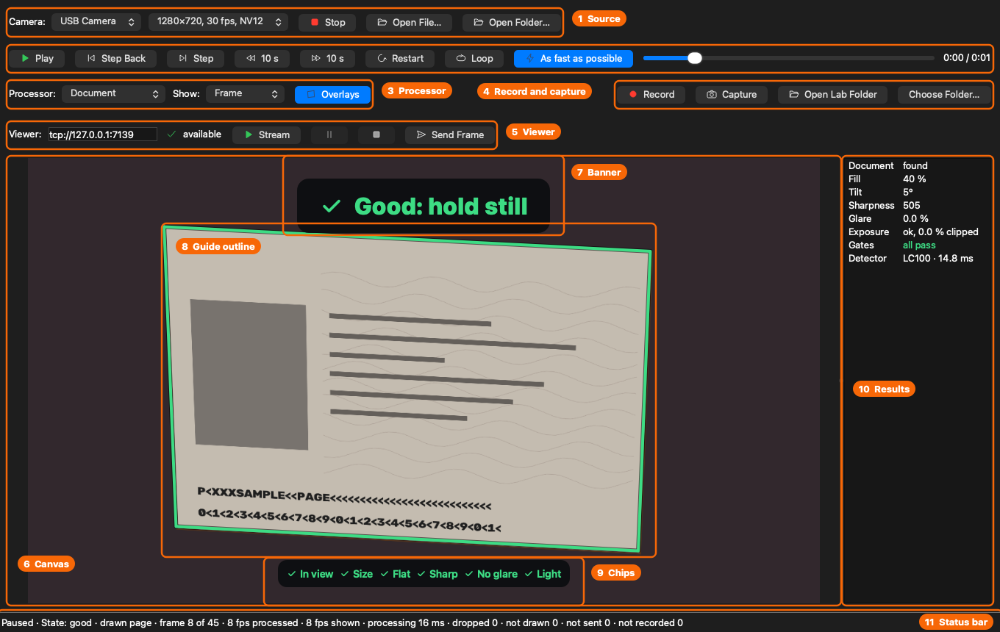

# User guide

How to run the viewer and the senders, what the viewer shows, and how to use `visual_debug` from your own
OpenCV program. To build everything first, see the [build guide](build-guide.md). Paths below are relative
to the repository root and assume the `debug` preset; replace `debug` with `release` for an optimised
build. The commands are macOS's; on Windows, see [Running on Windows](build-guide.md#running-on-windows): the
programs are `.exe` files under `build\windows-debug`, and take the same options.

## The programs

| Program | What it is for |
|---|---|
| `visual_debug_viewer` (the **Visual Debug Viewer**, or the viewer) | Shows every image sent to it, keeps a history of thumbnails, zooms, pans and reads out the original value of the pixel under the cursor. Can also open image files itself. |
| `visual_debug_example_sender` (the **Visual Debug Example Sender**) | A small Qt app: open an image file and send it to the viewer. Shows how a GUI application uses the library. |
| `document_lab` (the **Document Lab**) | The workbench for document-reading code: a camera (an iPhone through Continuity Camera too) or a video, image, folder or recording runs through a processor, and the results show over the frames. Records frames losslessly, captures one at full resolution, and sends to the viewer when asked (see [Running the Document Lab](#running-the-document-lab)). |
| `pipeline_demo` | A command-line OpenCV pipeline that sends the result of each of its ten stages. Exercises every image type the viewer handles. |
| `minimal_sender` | The smallest real use of the library: one include, one call per image. |
| `overlay_sender` | Sends a made-up ID card with overlays: the shapes a document detector would find in it, drawn by the viewer over the image (see [worked example 7](#7-show-what-your-code-found-overlays)). |
| `live_sender` | Streams a camera, a video file or a moving test pattern to the viewer as two live channels, the frames and their Canny edges, named after the source (`camera 0`, the video file's name) or as you name them. With `--hdr`, a phone's HDR video goes as 16-bit frames with its HDR tags; with `--outline`, each frame carries the outline of a card held to the camera as an overlay. It has no window of its own: the viewer shows the stream (see [Running live_sender](#running-live_sender) and the [tour of live channels](live-channels-tour.md)). |

All senders reach the viewer through the `visual_debug` library, over ZeroMQ on `tcp://127.0.0.1:7139` by
default; from Python, `python/visual_debug.py` does the same (see [Sending from Python](#sending-from-python)).
Start the viewer first.

## Running the viewer

```sh
open build/debug/apps/viewer/visual_debug_viewer.app
```

On Windows, with Qt's `bin` folder on `PATH`:

```powershell
build\windows-debug\apps\visual_debug_viewer.exe
```

The window opens maximised, with the keyboard on the sidebar's thumbnails. The sidebar, the status bar and
the activity log sit on a grey a step off the image area's background, in the light and the dark appearance
alike, and a thin line divides each from the image area; the dividers you can drag carry a small grip in the
middle. Around the image is the window's own background colour, which also follows the appearance. The title
names the image in the view and the endpoint without `tcp://`, for example
`Visual Debug Viewer — Sobel X — 127.0.0.1:7139`, so several viewers can be told apart in the Dock and the
**Window** menu. The right-hand end of the status bar shows the server's buttons, a state dot and the
connection state, then **Log ▴** at the far right (see [Activity log](#activity-log)):

| Status | Dot | Buttons | Meaning |
|---|---|---|---|
| `Starting…` | grey ring | none | The window is up; the viewer starts listening as soon as its event loop runs. |
| `Listening on [tcp://127.0.0.1:7139]` | green | Pause, Stop | Ready to receive. Senders started before this appears get `ViewerUnavailable`. |
| `Listening on […] (remote connections allowed)` | green | Pause, Stop | Started with `--allow-remote`; see the warning below. |
| `Paused: senders get [viewer paused]` | amber | Resume, Stop | The port stays taken; every image is refused. |
| `Stopped: released [tcp://127.0.0.1:7139]` | grey ring | Start | The port is free; senders find no viewer. |
| `Not listening: could not listen on [tcp://127.0.0.1:7139]: …` | grey ring | Try again | Usually another viewer already uses the endpoint. This window still works for opening files. |
| `Not listening: refusing to listen on […]: not a loopback address, and remote connections are not allowed` | grey ring | Try again | The endpoint is not on this machine; see `--allow-remote` below. |

### Server controls

The buttons, and the **Server** menu's **Pause** (⌘P) and **Stop** (⌘.), whose titles change to Resume and
Start, control the receiving side without closing the window. The two differ in what senders see:

- **Pause** keeps the port and answers every image with the error `viewer paused`, so senders get
  `Rejected` and go on running. Nothing new reaches the history until you resume. Use it to study the
  images you have while a pipeline keeps sending.
- **Stop** releases the port, so senders get `ViewerUnavailable`, exactly as if no viewer were running, and
  another viewer can take the port. **Start** listens again on the same endpoint. With `--endpoint` and port
  `*`, the new port can differ.

Images already received are never dropped by either. **Try again** retries a start that failed, for example
once the other viewer on the port has quit.

### Activity log

**Log ▴** in the status bar, or **View → Show Log** (⌘L), opens a panel under the image with what the
viewer did, newest at the top; **Log ▾** closes it. Drag the divider above it to change its height. The
viewer remembers whether the panel was open and how tall it was.

Each entry has the local date and time to the microsecond (`2026-10-27 13:02:44.907113`), a mark for its
kind (information, warning or error) and a text. The viewer logs:

- the server's state: listening, paused, stopped, or not listening and why;
- every received image, with its name, size, channels, depth and pixel bytes, timed when the server finished
  decoding it rather than when the window showed it;
- requests it refused, with the reason (`viewer busy`, a malformed message). Refusals that arrive while the
  window is busy are combined, `Rejected 3 requests: [viewer busy]`, and a sender that goes on being refused
  gets at most one line a second. While the viewer is paused, its refusals are only counted, and logged once
  when you resume or stop: `Rejected 900 requests while paused: [viewer paused]`;
- opened and saved files, renames, duplicates, deletes, undos and copies, and files it could not open or save;
- images dropped because the history is full: `Dropped the oldest image`;
- live channels (see [Live channels](#live-channels)): `Live channel [camera] started`,
  `Live channel [camera] idle after 1234 frames (12 dropped)` (the frames since it started, and how many of
  them were dropped), `Closed live channel [camera]`, `Live channel [cam9] replaced idle channel [camera]`,
  `Refused live channel [cam9]: 8 channels are open` (once per name, for up to 8 names; any more are counted
  as `Rejected 150 requests: [too many live channels]`, at most one line a second),
  `Muted live channel [camera]`, `Unmuted live channel [camera]`, and
  `Snapshot [camera 14:03:22.517] (640×480 · 3 ch · 8U · 921.6 kB)`. Never a line per frame, and no
  `started` or `idle after` lines for a muted channel.

Names, file paths, endpoints and refusal reasons are written in square brackets, so a name with spaces reads
plainly: `Renamed [old image.jpg] to [new image.jpg]`. Counts and sizes are not.

While the panel is closed, the status bar shows the newest entry's time and text, greyed out. The list shows
new entries at the top while it is scrolled to the top, and keeps the entries you are reading in place while
you read further down. **Copy** puts the selected entries on the clipboard as lines of text, newest first, or
every entry when none is selected. **Clear** empties the panel and the stored log, without asking.

**Kept between sessions.** The newest 1000 entries are stored in `activity.log`, in a folder per endpoint
(such as `tcp_127.0.0.1_7139`) under the viewer's data folder, readable by you only, and loaded at the next
start. The data folder is:

| Platform | Data folder |
|---|---|
| macOS | `~/Library/Application Support/Visual Debug Viewer/` |
| Windows | `%APPDATA%\Visual Debug Viewer\` (`C:\Users\<you>\AppData\Roaming\Visual Debug Viewer\`) |
| Linux | `~/.local/share/Visual Debug Viewer/` |

Three cases keep the log in memory only, and the log says so at start:

- a port of `*`, which changes on every start, so the folder could never be found again (an endpoint
  without `://` has no folder either, and cannot be listened on);
- a second viewer on the same endpoint, while the first one uses that endpoint's folder;
- a folder that cannot be created or written, such as on a full disk.

### Keeping images between sessions

**History → Keep Images Between Sessions** keeps the history on disk, so a viewer you quit and start again
on the same endpoint shows the same images, newest first, with their names (renames included), their
received and modified times and their original pixels at every depth. It is off by default.

- **What is stored, and where.** Each image is written as it arrives, as its original pixels, in the
  endpoint's folder under the viewer's data folder (such as `tcp_127.0.0.1_7139/images`; see the table
  above), with a small index of the order, names and times. An image's file is deleted
  when it leaves the history: deleted, or dropped because the history is full. **Undo Delete** writes it
  again. The undo buffer itself is not stored.
- **Starting again.** The viewer starts listening at once, then loads the stored images in the background
  and adds them below any image that arrived meanwhile. Newer arrivals take priority for the history's
  limits: a stored image that no longer fits is dropped and its file deleted. The log records
  `Restored N images`, and how many were skipped as damaged or dropped.
- **One setting for every viewer.** Turning it on writes this viewer's current history. Turning it off asks
  `Delete the N stored images?`, where N counts the stored images of **every** endpoint, and then deletes
  them all; other running viewers stop storing at once. Cancel leaves the setting on. A viewer that starts
  with the setting off also deletes images a crashed viewer left behind, but never those of a viewer that
  is still running.
- **Privacy.** The folders and files are readable by your user account only, but they are **not
  encrypted**: anyone with access to your account, or to a backup of it, can read the stored images.
  Leave the setting off for images that must not reach the disk. On Windows the viewer gives each folder
  an access list of its own that lets in only your account, SYSTEM and the Administrators group (an
  administrator can read any file on the machine anyway), whatever the folders above allow; where Windows
  cannot set one, the viewer keeps everything in memory. `%APPDATA%` is the roaming profile: on a domain
  with roaming profiles, stored images travel to the profile server when you sign out.
- **Clear History…** deletes every image of this viewer, in memory and on disk, after asking. It cannot be
  undone.
- **Port `*`.** A viewer whose port is `*` gets a different port, and so a different folder, on every
  start: it stores nothing and keeps its log in memory only.
- **Live channels.** Live frames are never stored, and neither are snapshots of them or copies of those,
  even with the setting on. Save As and Copy Image are the only ways a live frame leaves the viewer.

### Options

Pass options after `--args`. Add `-n` to start another instance; without it, `open` only brings a running
viewer to the front:

```sh
open -n build/debug/apps/viewer/visual_debug_viewer.app --args --endpoint tcp://127.0.0.1:7140
```

Or start the binary inside the bundle, which also inherits the terminal's environment and prints
`--help` to it:

```sh
build/debug/apps/viewer/visual_debug_viewer.app/Contents/MacOS/visual_debug_viewer --help
```

On Windows, pass options directly; each start is a new instance:

```powershell
build\windows-debug\apps\visual_debug_viewer.exe --endpoint tcp://127.0.0.1:7140
```

| Option | Effect |
|---|---|
| `--endpoint <uri>` | The ZeroMQ endpoint to listen on. Default: `$VISUAL_DEBUG_ENDPOINT` if set, else `tcp://127.0.0.1:7139`. |
| `--allow-remote` | Allow an endpoint that other machines can reach, such as `tcp://*:7139` or a network interface. |
| `--help`, `--version` | Print help or the version and exit. |

> **Warning:** the channel is neither encrypted nor authenticated. With `--allow-remote`, anyone who can
> reach the port can send images to your viewer, and images sent to it cross the network in clear text.
> Use it only on a network you trust.

### Viewer controls

| Action | Effect |
|---|---|
| Mouse wheel | Zoom in or out by 1.25× per notch, keeping the point under the cursor in place. Trackpad scrolling zooms smoothly. The closest zoom still shows at least 3×3 image pixels. |
| Drag with the left button | Pan. The image cannot be dragged past its edges. |
| Double-click | Fit the whole image to the window again. |
| Hover | The status bar shows the pixel under the cursor (see below). Leaving the image clears it. |
| Shift-drag | Draw a region: its size and each channel's minimum, maximum, mean and standard deviation show beside it (see [Region statistics](#region-statistics)). A click in the view, or Esc, clears it. |
| Click a thumbnail | Show that image, fitted. The newest image is at the top and is shown as it arrives, unless a live channel is in the view. |
| Click a live channel's row | Show that channel, updating in place (see [Live channels](#live-channels)). |
| ↑ and ↓ | With the sidebar focused, as it is when the window opens, show the entry above or below: the live channels first, then the images as listed (see [The sidebar](#the-sidebar)). |
| **File → Open…** (⌘O) | Open an image file (PNG, JPEG, BMP, TIFF, WebP, PNM, or anything else OpenCV reads). It is read with its original depth and channels, so a 16-bit PNG stays 16-bit, and joins the history like a received image. |
| **File → Save As…** (⇧⌘S) | Save the image in the view, as shown on screen, as PNG or JPEG. The suggested name is the image's name without an image-file extension (`photo.webp #3` suggests `photo #3.png`; `result v1.2` keeps its dot). `.png` is added if you type no extension. |
| **Quit** (⌘Q) | Quit. On macOS it is in the application menu (**Visual Debug Viewer**); on other systems in **File**. |
| **About Visual Debug Viewer** | What the viewer is, its version, and the OpenCV and Qt versions it runs with. On macOS it is in the application menu; on other systems in **Help**. |
| **Edit → Undo Delete** (⌘Z) | Bring back the last deleted image at its place in the list, and show it. The last 10 deletions can be undone. |
| **Edit → Rename…** (⌘R) | Rename the image in the view, in the info strip (see below). |
| **Edit → Duplicate** (⌘D) | Add a copy named `<name> copy` directly above the image, and show it. |
| **Edit → Copy Image** (⌘C) | Put the image on the clipboard, as shown on screen (see the note below). |
| **Edit → Delete** (⌘⌫) | Remove the image and show the next one down the sidebar, or the one above if it was last. With the default sort that is the next older image. If the search hides the deleted image, the first one listed is shown. |
| **Edit → Find…** (⌘F) | Put the cursor in the sidebar's search field, with its text selected. |
| **View → Show in Sidebar**, **View → Sort By** | The same choices as the sidebar's options button (see [The sidebar](#the-sidebar)). |
| **View → Show Log** (⌘L) | Open or close the activity log, as **Log ▴** in the status bar does (see [Activity log](#activity-log)). |
| **Image → Range**, **Image → Colours** | The same choices as the info strip's **Range** and **Colours** buttons (see [Display range and colours](#display-range-and-colours)). |
| **Image → Show Clipping** (⇧⌘K) | Mark the pixels at or beyond the ends of the range in use, in the view (see [Display range and colours](#display-range-and-colours)). Also at the foot of the **Range** button's menu. |
| **Image → Show Overlays** (⇧⌘O, or O) | Draw the shapes a sender attached to the image or frame over it, or hide them; on at every start (see [Overlays](#overlays)). O works from anywhere but a text field. Also the info strip's **◩ overlays** button. |
| **Image → Show Histogram** (⇧⌘H) | Show or hide a strip under the info strip with a histogram of the image or frame in view and the range in use drawn on it, whose ends you can drag (see [Display range and colours](#display-range-and-colours)). Off at the first start; the choice is kept. |
| **Image → Freeze** (⇧⌘T, or Space) | Keep a live channel's frame in view while frames go on arriving; again to show the newest. Space freezes from anywhere but a text field or a button that has the keyboard focus, which Space presses instead. Only while a live channel is shown (see [Live channels](#live-channels)). |
| **Image → Snapshot** (⌘T) | Copy what is in view of the live frame into the history, as `camera 14:03:22.517`: zoomed in, the visible area; fitted, the whole frame. Only while a live channel is shown. |
| **View → Appearance** | **System** (the default) follows the system's light or dark appearance; **Light** and **Dark** keep one whatever the system does. The choice is kept, and the example sender shares it (see [Running the example sender](#running-the-example-sender)). Needs Qt 6.8 or newer: built with older Qt, the menu is absent and both programs follow the system. |
| **History → Keep Images Between Sessions** | Store the history on disk, for every viewer (see [Keeping images between sessions](#keeping-images-between-sessions)). |
| **History → Clear History…** | Delete every image in this viewer, in memory and on disk, after asking. |
| Thumbnail icons | The pencil, two squares and bin beside a thumbnail rename, duplicate and delete that image (see [The sidebar](#the-sidebar)). |

The Edit menu acts on the image in the view. While you type in a text field, such as the rename field, ⌘C,
⌘Z and ⌘⌫ act on the text instead.

**Copy Image and Save As take the 8-bit picture on screen, not the original values.** Other programs cannot
take 16-bit, signed or floating-point pixels, so a Sobel result pastes as the stretched grey image you see,
in the display range and colours you chose. The readout (below) is where the original values are. With a live
channel in view, they take its frame on screen, and Save As suggests the name a snapshot of it would get.

The history keeps the newest 100 images, or fewer if they would hold more than 2 GiB of pixels; the
oldest are dropped first. The pixels counted are each image's original and its 8-bit copy on screen, and
they include the last deleted images that **Undo Delete** can bring back (these go first when room is
needed) and every duplicate, though a duplicate shares its original's pixels. An image just received or
opened is always kept, even one that is larger than the limit on its own; so is the original of a
duplicate.

### The sidebar

- **Width.** Drag the divider between the sidebar and the image to make the sidebar between 120 and 400 pixels
  wide. The thumbnails scale with it, and the viewer remembers the width.
- **Cells.** Every item has the same size: the image fitted and centred in its box, with its name and details
  (for example `640×480 · 1 ch · 16S · 614.4 kB`, as in the info strip) below. A long name is shortened in the
  middle. The tooltip shows the full name, the details, the time the image arrived and, if it was renamed or
  duplicated since, the time of that.
- **Selection.** The selected item is filled with a neutral grey, a little stronger while the sidebar has the
  keyboard, and keeps it while you work elsewhere in the window; the item under the pointer gets a lighter
  grey. Names, details and icons keep their usual colours, and a thin line separates neighbouring items.
- **Icons.** The selected item, and the one under the pointer, show three icons beside the picture:
  rename (pencil), duplicate (two squares) and delete (bin). Each icon's tooltip names its shortcut.
- **What items show.** The options button's **Show** menu (also **View → Show in Sidebar**) turns the
  Thumbnail, the Name and the Details on or off; all three are on at first, and the viewer remembers the
  choice. At least one stays on: the last one ticked cannot be unticked. Without the thumbnail, each item is a
  compact row, with the text on the left and the three icons in a row on the right, so a names-only list fits
  many more images. The icons' place is kept on every row, so the text never moves when they appear.
- **Right-click menu.** Rename…, Duplicate, Copy Image, Save As… and Delete, for the thumbnail clicked.
- **Keys.** With the sidebar focused (as it is when the window opens, or after clicking a thumbnail), ↑ and
  ↓ move through one list: the live channels that are not muted, in their order, then the images as listed,
  with the search and sort applied. Each one is shown as you reach it: ↑ from the first image shows the last
  channel, ↓ from the last channel the first image, and nothing happens past either end. With nothing
  chosen, ↓ goes to the first entry. Clicking a channel's row leaves the keyboard where it was. Delete or
  Backspace deletes the selected image. On a Mac keyboard the key labelled "delete" is Backspace.

#### Searching and sorting

The row at the top of the sidebar holds the search field and an options button, whose menu holds **Show**
(above) and **Sort By**.

- **Search.** Type part of a name: the sidebar lists the images whose names contain it, ignoring case, so
  `canny` finds `Canny edges`. Only names are searched, and the text is taken literally (no wildcards). While
  the field has text, a line below it counts the images listed out of all images, for example `2 of 10`.
  - Esc clears the search; Esc in an empty field moves to the list.
  - Enter or Down selects the first image listed and moves to the list.
  - ⌘F (**Edit → Find…**) jumps to the field from anywhere in the window.
  - The search starts empty every time the viewer starts.
- **The search never changes the image shown.** If it hides the image in the view, the view keeps showing it
  and the sidebar shows no selection; the Edit menu still acts on it. Images that arrive while the search hides
  them are added and counted quietly, without taking the view. Matching ones are shown as they arrive, so
  searching `Canny` while `pipeline_demo` runs shows each new Canny image and lets the other stages pass.
- **Sort.** The options button's **Sort By** menu (also **View → Sort By**) offers:

  | Key | Natural direction | Sorts by |
  |---|---|---|
  | Time Received (default) | Newest first | The order images arrived in. A copy sits directly above its original, and an undone delete returns to its place. |
  | Time Modified | Newest first | The last rename or duplication; an image never renamed counts its arrival. |
  | Name | A to Z | The name, as Finder sorts it: ignoring case, with numbers by value (`stage 2` before `stage 10`). |
  | Size | Largest first | The bytes of pixel data, also for an opened file (not its size on disk). |

  Choosing a key sets its natural direction; **Ascending** and **Descending** then flip it. Images with equal
  keys stay newest first. The list re-sorts at once when an image arrives or is renamed, and the viewer
  remembers the sort.

### Live channels

A program that sends each frame with `visual_debug::sendLive(frame, "camera")` (see
[worked example 1](#1-one-line-debugging-with-sendimage)), such as `live_sender`, streams it as a **live
channel**: the viewer shows the channel's newest frame in place, instead of adding every frame to the history.

- **The Live group.** While channels exist, a **Live** group sits at the top of the sidebar, above the search,
  with a row per channel in the order they started: the newest frame (in the channel's range and colours),
  the channel's name on one line, its frame rate (`30 fps`: frames that arrived in the last second) and its
  state as a dot and a word or two. The dot is in the accent colour while frames arrive, grey otherwise. The
  words are **live** while frames arrive; **idle** once none has come for 3 seconds; **frozen** while frozen;
  **muted** while muted (below); and **frozen · idle** or **muted · idle** for a frozen or muted channel that
  has gone idle. Three rows show at first; more scroll, and the arrow keys scroll the row they reach into
  view. Drag the grip below the rows, which looks like the sidebar's divider, to show more or fewer of
  them at once, in whole rows, from one to all eight; the viewer remembers how many.
- **Showing a channel.** Click its row, or reach it with ↑ and ↓ (see [The sidebar](#the-sidebar)). The
  first channel to start is shown at once if nothing else is in the view. The view shows a history image or a
  channel, never both: clicking a thumbnail leaves the channel, and clicking the row again returns to it.
  Frames of the same size keep the zoom and pan; a frame of another size is fitted. The readout reads the
  original values of the frame on screen, and the window's title names the channel.
- **Nothing takes its place.** While a channel is shown, images that arrive are listed in the sidebar without
  taking the view, so the stream stays in view. Rename, Duplicate and Delete are off; Copy Image and Save As
  take the frame on screen.
- **The info strip** shows, for example,
  `camera  live · 1920×1080 · 3 ch · 8U · 30 fps in · 30 drawn · 12 dropped · 18 ms`: the state, the frame's
  size and type (and its description, if the sender gave one: see [The info strip](#the-info-strip)), the
  frames that arrived and the frames the view drew in the last second (a frame drawn again for a new range or
  a zoom counts once), the frames dropped since the channel's row appeared, idle spells included (frames that
  never reached the screen: a newer frame arrived before the viewer could take the older one, or before it
  had converted it for the screen), and the frame's
  age: the time it arrived minus the time the sender stamped on it. The age compares two clocks, so it means
  something only when sender and viewer run on one computer; a frame without a stamp shows none. The counters
  refresh twice a second.
- **Freeze** (**Image → Freeze**, ⇧⌘T, Space, or the strip's **Freeze** button) keeps the frame in view while
  frames go on arriving and being counted; freezing again shows the newest. Each channel is frozen on its own.
- **Snapshot** (**Image → Snapshot**, ⌘T, or the strip's **Snapshot** button) copies what is in view of the
  frame, frozen or not, into the history as `camera 14:03:22.517`, its arrival time to the millisecond, with the
  channel's range and colours. Zoomed in, that is the area in view, every pixel at least partly visible, cut from
  the original at full resolution with the shapes over it, and the log says where it was cut (`cut from the
  frame at 812, 400`); its readout counts from the cut's corner. Fitted, it is the whole frame. The snapshot
  is prepared beside the window, so the stream goes on meanwhile and the snapshot is listed a moment later,
  without taking the view. The channel stays in view. Snapshots stay in memory, even with Keep Images Between
  Sessions on.
- **Muting.** A channel you do not want to see, such as a second camera, can be muted: hover its row and
  click the eye with a stroke through it (it also shows on the row in view), or right-click the row and
  choose **Mute**. The row reads **muted**, keeps the picture it had, greyed, and shows no rate; its button
  stays visible and pressed. A muted channel's frames are still accepted, so its sender gets `Delivered` and
  is never slowed down, and still counted, so it still goes idle and comes back; but nothing is converted or
  drawn for it. It never takes the view: muting unfreezes a channel, muting the one in view shows the image
  you looked at before it, clicking its row does nothing, and ↑ and ↓ skip it. The log says when it is muted and
  unmuted, and nothing else about it meanwhile. Mute belongs to the name until the viewer quits: a muted
  channel that is closed and comes back is still muted. Click the button again, or choose **Unmute**, to
  see it.
- **Closing.** A channel that has gone idle shows a close button (✕) on its row, frozen or muted or not; the
  right-click menu's **Close** is enabled at the same time. One that still streams has none: stop its sender,
  and 3 seconds later it is idle. Closing the channel in view shows the image you looked at before it, if it
  is still in the history. A sender can also end its channel itself (the Document Lab's ■ does, and
  `visual_debug::endLive` or Python's `end_live`): the viewer closes it as the button would and logs
  `Live channel [lab] ended by its sender`, except a channel you froze, which stays until you close it. A still image
  a sender sends while a live channel is shown goes to the history without taking the view.
- **Limits.** At most 8 channels, whose newest frames may hold 1 GiB together. A ninth channel takes the place
  of the one that has been idle longest, never the one in view; with all 8 active, its frames are refused,
  and its sender gets `Rejected` (`too many live channels`). So does any frame that would take the channels
  past 1 GiB, unless closing idle channels makes room. Keep a channel's name the same for the whole stream: a
  name with a frame number in it makes every frame a new channel. A sender is never slowed down: the viewer
  keeps one waiting frame per channel, the newest, and counts the older ones it replaces as dropped.
- **Large frames.** A frame drawn smaller than its own pixels, such as a 4K frame fitted to the window, is
  shrunk to the drawn size before it is coloured and drawn, instead of being converted whole and scaled on
  screen; zooming or resizing the window redraws it at the new size. Zoomed in, only the part in view is
  converted, with a quarter of the view's width and height around it, so a short pan shows pixels at once; a
  longer pan shows the window's background at the edge until the next picture, converted at once even for a
  frozen frame, fills it. Under Auto the part is stretched with the whole frame's range, so it looks as it
  does fitted. The readout, Copy Image, Save As and the histogram always use the full frame; Snapshot takes
  what is in view.
- **Converted beside the window.** The channel in view is converted for the screen, and its histogram
  counted, on a thread of its own, so the window stays free to draw and to answer the mouse while frames
  stream. When frames come faster than they can be converted, the newest waits and older ones are skipped,
  counted as dropped. The readout, region statistics and Freeze use the newest frame taken, which can be a
  frame ahead of the picture for the few milliseconds its conversion takes.

### The info strip

One line above the image shows its name, a pencil and its details, for example
`Sobel X ✎  640×480 · 1 ch · 16S · 614.4 kB`. The size is the image's pixel data (rows × columns × bytes per
element) for a received image, and the file's size on disk, marked `file`, for an opened one. Sizes use decimal
units, as Finder shows them. With no image, the strip is hidden. At its right end are the **Range** and
**Colours** buttons (see [Display range and colours](#display-range-and-colours)) and, while a live channel is
shown, **Freeze** and **Snapshot**; a live channel's name has no pencil. Before them, while the image or frame
in view has overlays, a **◩ 3 overlays** button switches them off and on, and reads **◩ 3 overlays hidden**
while they are off (see [Overlays](#overlays)).

An image sent with a description (see [worked example 1](#1-one-line-debugging-with-sendimage)) names it
after its type: its transfer, primaries and value range, for example
`Horses close to Tegernsee.MOV  live · 3840×2160 · 3 ch · 16U · HLG · BT.2020 · 4100–60219 · …` for a frame
of an iPhone's HLG video from `live_sender --hdr`. The description stays with the image in the history, its snapshots and duplicates, and
the images kept between sessions.

**Renaming.** Click the pencil (here or on the thumbnail) and type. Enter saves, Esc cancels, and clicking
elsewhere saves, as in Finder. The rename stays with the image it started on, even if new images arrive
meanwhile.

### Reading pixel values

The readout uses the **original** image as it was sent, not the 8-bit picture on screen:

```text
X=12 Y=40 · B=12 G=200 R=3
```

| Channels | Labels |
|---|---|
| 1 | `I` (intensity) |
| 2 | `C0 C1` |
| 3 | `B G R` |
| 4 | `B G R A` |

Integers print exactly, including negative values of signed images. Floating-point values print with up
to six significant digits, always with a decimal point regardless of the system's language settings.

### Region statistics

Shift-drag in the view to draw a rectangle. It is outlined, and a label beside it gives its size and place and,
per channel, the minimum, maximum, mean and standard deviation of the original values. Over a whole 2×2
floating-point BGR image whose one green value is NaN:

```text
2×2 at 0, 0
B  min 0.25 · max 0.25 · mean 0.25 · σ 0
G  min 1.5 · max 1.5 · mean 1.5 · σ 0
R  min 1000 · max 1000 · mean 1000 · σ 0
1 not finite
```

The labels and number format are the readout's; the mean and σ (the population standard deviation) have up to
four significant digits. NaN and infinite values are left out of the figures and counted on the last line.
The region stays while the images or frames shown have the same size, so you can compare them; on a live
channel its figures follow the frame in view, refreshed twice a second. A click in the view, Esc (unless a text
field has the keyboard), or an image of another size clears it. A plain drag still pans.

### Overlays

A sender can attach shapes to an image or a live frame: what its code found in it, such as a document's
outline, the holder's photo or an MRZ band (see [worked example 7](#7-show-what-your-code-found-overlays) and
`live_sender --outline`). The viewer draws each one over the picture as a see-through fill with a solid edge in
the shape's colour (light green unless the sender names another), with its label on a small tab at its
top-left corner. The shapes follow the zoom and pan; the edges, the dots of points and the tabs keep their size
on screen, so the shapes stay sharp at any zoom.

One switch shows or hides them all: **Image → Show Overlays** (⇧⌘O, or O), or the **◩ overlays** button in the
info strip, which shows only while the picture in view has overlays and counts them. The switch is for the
viewer as a whole, so an image shown after it is off shows its overlays hidden too, and it is on again at every
start.

Overlays change only what the view draws. The pixel readout, region statistics and Show Clipping read the
original values; Copy Image and Save Image give the image without them; thumbnails and live rows show none.
Overlays stay with their image: a live frame shows its own, and a frozen frame keeps them, a snapshot and a
renamed image keep them, and so do images kept between sessions. A kept image renamed to a much longer name may
keep fewer of them if its header would otherwise pass the format's 64 KiB.

### How images are displayed

| Image | On screen |
|---|---|
| 8-bit unsigned | Values as they are. |
| Any other depth (8-bit signed, 16-bit, 32-bit integer, 32- and 64-bit floating point) | Stretched so the smallest value in the image is black and the largest white, across all channels together. A constant image is black. NaN and infinite values are ignored when stretching and shown black. |
| 1 channel | Grey. |
| 2 channels | Channel 0 as red, channel 1 as green (useful for optical flow). |
| 3 channels | Read as BGR, OpenCV's order. |
| 4 channels | Read as BGRA; transparent areas show a grey checkerboard, in greys that suit dark or light mode. |

**Save As…** writes this displayed version; PNG and JPEG cannot hold every depth.

### Display range and colours

The info strip's **Range: Auto ▾** and, for a single-channel image, **Colours: Grey ▾** change how the
picture in the view maps the original values to the screen, for history images and live channels alike. The
**Image** menu holds the same choices. The readout still shows the original values.

| Range | On screen |
|---|---|
| **Auto** (the default) | As in the table above: 8-bit values as they are, other depths stretched from each image's smallest value to its largest. |
| **Hold** | The range Auto shows now, kept for the frames that follow, so a live channel's brightness stops changing with each frame's range. |
| **Fixed…** | A minimum and maximum that you type, with a full stop as the decimal mark. **Apply** is enabled while the minimum is below the maximum. The popup opens below the Range button, its right edge at the button's, and moves left or up as needed to stay inside the window and the screen. |
| **HDR** | Only for an image or frame tagged HLG or PQ, such as `live_sender --hdr`'s, and the default for its name until you choose another range. Tone-maps the video for this screen (see below). |

Hold and Fixed apply to 8-bit images too. The minimum shows black and the maximum white, and values outside
the range are clipped to them.

**A sender's value range.** An image sent with a value range (see
[worked example 1](#1-one-line-debugging-with-sendimage)) is shown by Auto and Hold from that range's minimum to
its maximum, instead of from its own smallest to largest value, so a 10-bit picture held in 16 bits, or a
mask from 0 to 1, shows right without typing a Fixed range, and a live channel's brightness stops changing
with each frame. Values beyond the range are clipped. Fixed overrides it.

**HDR.** HLG and PQ video keeps its highlights above the white an SDR screen can show. The HDR range turns the
signal into light as ITU-R BT.2100 defines it (a 1000 cd/m² peak), puts HDR reference white (203 cd/m²,
ITU-R BT.2408) just below the screen's white and compresses brighter light smoothly into the room above it,
converts BT.2020 colours to BT.709, and encodes the result for an sRGB screen. An HLG video's codes above its
nominal white are highlights, kept up to the top of the scale, so glare keeps its gradations; PQ is clipped at
its nominal 10 000 cd/m². Auto, Hold and Fixed still show such an image's raw signal, which is what to use to
read values against a range: raw HLG looks reasonable on an SDR screen, raw PQ dark. A frame of whole numbers
drawn smaller than its pixels is shrunk before it is tone-mapped; a floating-point one after.

**Show Clipping** (**Image → Show Clipping**, ⇧⌘K, or the foot of the **Range** menu) marks the pixels whose
original value is at or beyond an end of the range in use: magenta at or above the maximum, blue at or below
the minimum (white under Turbo and Viridis, which have blue). A pixel is marked when any channel is at an end,
magenta when one channel is above and another below; alpha, a fourth channel, never marks one. Under HDR "above" means the top of the scale, the
camera's own clipping; under Auto or Hold with a video's value range it means brighter than nominal white.
Auto on an image without a value range stretches the image's own extremes to black and white, so it marks
nothing, apart from 8-bit images at 0 and 255. A shrunk picture keeps every mark: a block with a marked pixel
is marked. The marks are in the view only, never in thumbnails, live rows, Copy Image or Save As, and the
setting holds for every image until the viewer quits.

**Histogram.** **Image → Show Histogram** (⇧⌘H) opens a strip under the info strip with a histogram of the
image or live frame in view: one curve per colour channel, in the colour the view shows it (blue, green and red;
red and green for two channels; one curve for a single channel, whatever its colour map). It counts the original
values, not the picture. Alpha, a fourth channel, is left out; NaN and infinite values are left out and counted
over the whole image ("12 NaN/∞ left out"). A large image is counted on an even grid of its pixels, every n-th
across and down, and the tooltip says so ("sampled: 1 pixel in 16"); its smallest and largest values still come
from every pixel. The axis spans the image's values and the range in use, with a little room either side, so the
values the range clips are in view; whole numbers fall in bins of whole codes. Two lines mark the range in use,
what shows black and what shows white: for Auto the image's own extremes, a sender's value range, or 0 and 255
for 8-bit; for Hold and Fixed their own; under HDR the video's black and nominal white, with a dashed line at the
top of the scale. Hovering shows a bin's values and each channel's share of the values counted.

Drag a line to move that end, or drag between the lines to move both and keep the width; the picture follows,
and the ends of a whole-number image snap to whole codes. Under Auto, Hold and Fixed a drag sets a Fixed range.
Under HDR it moves the video's black and white instead, and the picture stays tone-mapped: the **Range** button's
tooltip names them, **Fixed…** starts from them, and choosing **HDR** in the Range menu returns to the sender's.
Double-click the strip to return to the name's default range (Auto, or HDR for HLG and PQ), keeping the colours.
Right-click it for **Linear Counts** or **Log Counts**; the log scale keeps one tall peak, such as a black border
or an empty mask, from flattening the rest, and the choice is kept. With a live channel in view the strip follows
every frame drawn. It is computed only while it is shown.

One limit, open with the question of what "clipped" means for PQ: HLG highlights above nominal white are shown
up to the headroom a 12-bit video has. With HDR's white dragged far down, the picture clips below the top of the
scale, while the dashed line and Show Clipping still name the top.

| Colours | On screen |
|---|---|
| **Grey** (the default) | Grey levels. |
| **Turbo** | OpenCV's Turbo map, from dark blue for low values through green to dark red for high ones. |
| **Viridis** | OpenCV's Viridis map, from dark purple to yellow, which keeps its order in grey print and for most colour-blind readers. |

NaN and infinite values stay black under every map. The **Colours** button shows only while the image, or the
live frame in view, has one channel (the **Image** menu's choices are disabled otherwise), and follows a live
channel frame by frame if its channel count changes. A range as wide as −1e308 to 1e308 still maps linearly.

The choice is kept for the image's name until the viewer quits: other images of that name, later arrivals
among them, look the same; a rename takes it along; a snapshot takes its channel's. Thumbnails and live rows
show each image with its name's range and colours, and change with them. Copy Image and Save As take the
picture as shown.

## Running the example sender

```sh
open build/debug/apps/example_sender/visual_debug_example_sender.app
```

The Visual Debug Example Sender shows how a Qt application uses the library. Its icon, a white paper
plane in the viewer's blue ring, tells it apart from the viewer's eye in the Dock. The bar along the top, on the same panel grey as the viewer's sidebar, holds **Open…** (Ctrl+O), **Send
image** (Ctrl+Return) and the **Send to** field with the endpoint images go to; the preview fills the rest of
the window. Open an image and a preview appears;
**Send image** stays disabled until then. Each send shows its name and result in the status bar, such as
`[photo.png #1]: Delivered` (see [Send results](#send-results)).

The viewer shows the image as `<file name> #1`, then `#2` for the next send, and so on. A send the viewer
did not take (`Viewer unavailable`, `Rejected`, `Invalid image`, `Invalid endpoint`) keeps its number, so
the next send uses it. `Timeout` uses up its number, because the image may still have reached the
viewer. The numbers count every send of the session, whichever file it was, and start again
at `#1` when the example sender restarts.

**View → Appearance** offers the viewer's System, Light and Dark choices, and the two programs share one
setting: choose Dark in either, and the other turns dark when you next switch to it. With Qt older than 6.8
the example sender has no View menu. **About Visual Debug Example Sender** sits in the application menu on
macOS, and in **Help** elsewhere.

**Send to** starts with `$VISUAL_DEBUG_ENDPOINT` if set, otherwise with the endpoint the example sender last
sent to, otherwise with `tcp://127.0.0.1:7139`. Edit it to send to another viewer, such as one started with
`--endpoint tcp://127.0.0.1:7140`; the next send goes there, and the example sender remembers it for the
next start.
A send that finds the endpoint unusable (`Invalid endpoint`, for example `tcp://localhost` without a port)
outlines the field in red until you edit it, and is not remembered. A variable set to
`tcp://127.0.0.1:7139` itself counts as unset, so the remembered endpoint is used.

## Running the Document Lab

```sh
open build/debug/apps/document_lab/document_lab.app
```

Start it with `open` or from Finder: macOS asks for camera access on behalf of the app that started it, so
started from a terminal it asks for the terminal (see the [build guide](build-guide.md#building)).



The window has four rows of controls above the canvas: the source (a camera, or **Open File…** and **Open
Folder…**), the replay, the processing (the processor, Show, Overlays, Record and Capture) and the viewer. Every
button has a tooltip. The green ▶ starts (a camera, a replay, a stream), the red ■ stops, and the red ● records;
the toggles (**Loop**, **As fast as possible**, **Overlays**) draw their icon in the accent colour while they are
on, so on and off differ in light and dark appearance alike.

### Cameras

The **Camera** picker lists the cameras macOS, Windows or Linux offers, an iPhone through Continuity Camera
among them on a Mac (the iPhone near, on the same Apple Account, Wi-Fi and Bluetooth on), and follows them as
they come and go. The format picker lists each way the camera can deliver frames once (size, rate, pixel
format), and starts on the largest uncompressed one up to 60 fps; the lab remembers the camera and each
camera's format. Nothing starts until you press **Start**. The first Start asks for camera access; refused,
the status bar says where to allow it (on a Mac, System Settings → Privacy & Security → Camera). Another camera
or format while running starts a new run; a camera that fails or is unplugged stops it, and the status bar
says why. **Stop** empties the canvas. A camera frame's time counts from the run's first frame, as a replay's
does.

### The canvas, Show and Overlays

The canvas is the viewer's: the wheel zooms at the cursor, a drag pans, a double-click fits. **Processor**
chooses what runs on each frame: **None**, **Edges** (the frame's edges as a picture, and their share of the
frame), **Document** ([below](#the-document-processor)) or **Outline (simple)**, which outlines the largest four-sided shape lighter than the frame around it,
covering a tenth of the frame or more, and draws it over the frame. It is simple on purpose: a lit wall, a
window or a sheet of paper is such a shape too, so it says `Document: found` for them as well; the Document
processor tells a passport's page from them. **Show** chooses what the canvas shows:
the **Frame**, or a picture the processor made, such as `edges`; a picture the frame on screen does not have
says so instead of showing an older one. Choosing another processor leaves only its own pictures in the list,
and the frame shows until a picture of the name chosen comes back. **Overlays**, on from the start, draws what
the processor found over the frame; turned off, only the drawing goes.

The results panel beside the canvas lists the processor's findings for the frame on screen as rows of a name
and a value, such as `Document` and `found`, the value in green for good news and red for bad (in the
appearance's own shades); a processor's error is a red row of its own. It keeps its width as the
window grows; drag its edge to change it, or all the way to the window's side to shut it, and back to open it.
**View → Results** shuts and opens it too, and the lab remembers its width and whether it shows.

The status bar shows the run (Live, Playing, Paused, Ended, Stopped), then the news (the document's state, a
focus note, why something failed) so that a narrow window still shows it, then the source, the frame and of how
many, the frames processed and shown per second, the processing time, and four counts: frames **dropped** (a
camera's frame replaced by a newer one before it was processed), **not drawn** (results replaced before the canvas
drew them), **not sent** and **not recorded**. A processor busy for more than a second on one frame is named, with
how long; a seek on its way says `seeking…`. With no camera connected, the empty canvas says so: "No camera
found. Connect one, or open a video, an image or a folder of images."

### The Document processor

**Document** guides you to hold a passport's data page so that the next steps can read it. DocAligner LC100, a
small page model run on ONNX Runtime, finds the page's four corners in each frame; six checks judge the page;
and one hint at a time, in a banner at the top of the canvas, says what to change. It works on a camera and on
every replay, so the checks can be tried on recorded clips. What it says speaks of the **document**, since an ID
card has no page; until the MRZ is read (A4), the lab cannot tell a passport from a card, and its checks measure
the passport's data page (TD3).

- **The banner** shows the first hint that applies, checked from the top:

  | # | When | Banner |
  |---|---|---|
  | 1 | No page found | Show the document · the side with the photo, all of it in view |
  | 2 | The page is cut by the frame's edge | ✗ Move back · the whole document must be in view |
  | 2b | Cut by the edge, but small enough to fit | ✗ Move the document to the middle · the whole document must be in view |
  | 3 | Too far: its longer side under 40% of the frame's | ✗ Move closer |
  | 4 | Too close: it fills more than 92% of the frame's width or height | ✗ Move a little further away |
  | 5 | Tilted more than 25° from facing the camera | ✗ Hold the document flat to the camera |
  | 6 | Blurred | ✗ Blurred: hold still · or move a little closer or further away |
  | 7 | Glare on the page | ✗ Glare on the document · tilt it slightly away from the light |
  | 8 | Too dark | ✗ Too dark · add more light |
  | 9 | Too bright | ✗ Too bright · move out of direct light |
  | 10 | Every check passes | ✓ Good: hold still |

- **No flicker, bad news fast:** "Good: hold still" shows once every check has passed for half a second, and
  gives way to a problem that has held for a tenth of a second; any other hint shows once it has held for 0.3 s
  and stays at least 0.8 s. Each check fails at one value and passes again only a little beyond it, and a page
  lost for a third of a second keeps its outline, its checks and the banner. The times are the frames' own, so a
  replay behaves the same at any speed; a seek, a restart or a loop starts the hints over.
- **The chips** under the canvas show the six checks at once, ✓ or ✗: **In view**, **Size**, **Flat**,
  **Sharp**, **No glare** and **Light**, while a page is found.
- **The outline** of the page is red, and turns green with "Good: hold still". It shows only over the Frame,
  and hides with **Overlays**; the banner and the chips do not.
- **The results** list `Document` (`found` or `not found`), `Fill`, `Tilt`, `Sharpness`, `Glare` and
  `Exposure` while a page is found, then `Gates` (`all pass` in green, `5 of 6 pass` in red, `no document yet`)
  and `Detector` (the model and its time). A failing measure is red, with its limit: `Sharpness 41 (min 50)`.
- **Show → document** shows the page flattened, as the checks see it.
- **The status bar** adds the state: `State: searching`, `State: adjust (sharpness)` (the check to fix) or
  `State: good`.
- **The viewer and captures** get the outline as an ordinary polygon labelled `Document`, green or red.

While Document is chosen and nothing runs, the banner says why instead: **No camera found**, **Camera access is
off** (with where to allow it), **The camera stopped** (with the reason), or **Start the camera** when one is
connected. From the moment a camera or a replay starts, it asks for the document.

**The model and privacy.** Everything runs on this computer: no frame, page or result leaves it, unless you
stream or send to a viewer yourself. The model comes with the lab: the build fetches it once, checks it and
copies it beside the program ([build guide](build-guide.md#the-models)); the lab never downloads anything. If
the model is missing, or the ONNX Runtime the lab loads is older than the one it was built with (on Windows,
the one in `System32` when the lab's own copy is gone), the banner says "The document model is missing" or
"ONNX Runtime could not be loaded" for the whole run, the status bar gives the reason, and the other processors
work as before.

### Focus on the page

A blurred page cannot be read, and many webcams leave a passport held close blurred. Where the lab can set a
camera's own focus (a UVC camera such as the Logitech C920 on macOS, or a camera whose driver offers focus on
Windows), it focuses on the page itself; where it cannot, it says so. Qt Multimedia offers no focus control for
these cameras, so the lab reaches each camera's own controls directly ([ADR-005](ADR/ADR-005-camera-focus.md)).

- **The camera's own autofocus stays on** until the lab needs to take over.
- **On the page:** when a page is found, held steady, and sharpness is the first check it fails (it is in view,
  the right size and flat) for 1.5 s, the lab searches the camera's focus positions for the one where the page is
  sharpest, then holds it. The banner says **Hold still: focusing** meanwhile, the Sharp chip shows ✗, the
  outline stays red, and the status bar then gives the time it took: `Focused at 30 in 2.4 s`. Moving the page
  nearer or further (its size changing by more than 15%), or taking it away for a second, gives the focus back to
  the camera. The lab searches at most twice for the same page; if it is blurred again after that, the camera's
  own autofocus gets it back.
- **A click on the picture** (with Show on **Frame**, during a camera run) focuses on the area around the click,
  a square a fifth of the frame's shorter side wide; **F** focuses on the centre of what the canvas shows. The
  status bar says `Focusing…`, then `Focused at 30: 12 → 210` (the area's sharpness before and after) or `Could
  not focus there`. A click's focus stays until another click, a page search or the end of the run. A
  double-click still fits the picture to the window and never focuses.
- **When the page cannot be made sharp:**

  | When | Banner |
  |---|---|
  | The lab searched every position and none was sharp | ✗ This camera can't focus this close · Move the document a little further away |
  | The lab cannot set this camera's focus (its own autofocus, if any, did not manage in 3 s, the page held steady) | ✗ This camera can't make the document sharp · Try more light, or another camera |

  Either shows only while the shown hint is **Blurred**: a page that is too far, cut off or tilted keeps its own
  hint. On Linux the lab cannot set any camera's focus yet, so only the second applies.
- **The results** gain a **Focus** row for camera runs: `camera` (the camera's own autofocus), `camera (lab
  can't set it)`, `lab searching`, `lab, 30` (the position held) or `can't focus` (red).
- **Putting the focus back:** when the lab lets go, and whenever the camera stops, changes or the lab quits, the
  camera's focus goes back to what it was: its autofocus on, or the position it had. If that fails, the status bar
  says so, through later runs and files too, until a camera's focus has been put back: unplug the camera and plug
  it in again.
- **If the lab crashes** while it holds the focus, the camera stays in manual focus until it is unplugged and
  plugged in again, or until another program turns its autofocus on.
- **Recordings** made while the lab searches hold deliberately blurred frames; for an evaluation, record with
  the page already sharp. Nothing about focus is sent to the viewer.

### Replay

**Open File…** replays a video or an image; **Open Folder…** a folder of images (in name order, numbers in
names compared as numbers, 30 frames a second) or a recording. Every frame is processed, in order, at the
video's pace or slower: a frame the processing could not keep up with is shown late, never skipped.
**Play**/**Pause**, **Step Back** and **Step** (the frame before and the next), **10 s** back and forward,
**Restart**, **Loop** and **As fast as possible**. Space plays and pauses, ← and → step, Shift+← and Shift+→
jump ten seconds, except while a button has the focus, when Space presses it. The canvas has the keyboard from
the start, takes it back when a source opens or you click it, and Space plays and pauses in the viewer's address
field too, which never holds a space. **Play** at the end plays the replay again from its first frame.

Beside them, the position slider and the time of the frame on screen against the replay's length, such as
`0:16 / 0:25` (`1:02:03 / 1:10:00` from an hour). Dragging moves only the time; letting go, a click beside the
handle or a key goes to that frame. A seek, a step back or ten seconds is a new run of the processor, playing on
if the replay was playing and paused on the frame otherwise.

Videos are read through FFmpeg's libraries where the lab has them (every build the
[build guide](build-guide.md) describes does): a video lands on the exact frame asked for, decoded forward from
the keyframe before it, which in a 4K video takes a moment; holding ← makes one seek, not one per key press.
Videos decode on the graphics hardware where it can (VideoToolbox on a Mac, D3D11VA on Windows; the processor
on Linux), except H.264 on a Mac, which FFmpeg's own decoder reads and seeks in faster than VideoToolbox does. A video whose frames
carry no times (a raw `.h264` stream) can only start again. In a video of varying frame rate, such as an
iPhone's, frame numbers are counted at its average rate, and a seek lands on the first frame at or after that
time. A video that is damaged part-way stops with `stopped at frame N:` and the reason, never as its end. 10-bit
and HDR videos (an iPhone's HLG, PQ) are read as 16-bit frames with their tags; other videos as 8-bit frames.

### Record and Capture

**Record** writes every frame the processor gets, losslessly, as a new folder named by the local time in the
lab's folder, readable by you only; **Record** again, **Stop**, **Restart**, a seek (the slider, **Step Back**,
**10 s**), a loop, another source or another camera format ends it, a seek with `recording stopped: the replay
moved` in the status bar. Stopping, or closing the lab, waits until every frame is written, with the progress in
the status bar. A camera's frame that finds the queue full is left out and counted; a replay waits instead.
Recording stops when the disk has less than 5 GB free, and when a frame cannot be written (a disk unplugged, a
file in the way), with the reason in the status bar; `recording.json` then lists only the frames written. A
recording replays through **Open Folder…**.

**Capture** keeps the frame on the canvas at full resolution as a PNG, with a JSON beside it (the source, the
frame's number, its time, its tags, the processor's findings and its overlays: where it found what it found), in
the `Captures` folder.

The lab's folder is the app's local data folder (`~/Library/Application Support/Document Lab` on a Mac,
`%LOCALAPPDATA%\Document Lab` on Windows, `~/.local/share/Document Lab` on Linux), which iCloud and OneDrive do
not sync. **Open Lab Folder** shows it; **Choose Folder…** picks another, with a reminder that recordings may
show real passports and should stay out of synced or shared folders.

### The viewer

The **Viewer** row holds the viewer's address, a mark and a word saying whether it is there, the stream's
▶ ⏸ ■ and **Send Frame**.

- **Is it there?** The lab asks the viewer every two seconds with a [ping](wire-format.md#requests-ping-and-end),
  which the viewer answers without logging it: a green tick and **available**; **available (older viewer)** for
  a viewer from before the ping, asked once a minute instead because it logs each ping as a rejected request
  (while streaming to it, the stream's own replies decide the mark); **paused** for a viewer you paused; a red
  cross and **not available** or **invalid address**; **checking…** until the first answer; **no address** with
  the field empty, which also disables the stream and Send Frame.
- **Another computer.** An address that is not this computer's gets nothing, not even a ping, until you agree,
  once per address and session, that frames may show real passports and travel there unencrypted; until then
  the row says **another computer: not checked**, and ▶ or Send Frame asks first. While streaming there, the
  status bar names the host.
- **▶ Stream** sends each result as it is processed: the frame as the live channel `lab`, with the processor's
  overlays, and each picture as `lab <name>`, such as `lab edges`. A slow or absent viewer never slows the lab;
  the status bar shows the viewer's last reply and the results not sent. A stream starts only when you press ▶,
  never by itself at launch. **⏸** pauses it: the viewer keeps showing the last frame sent, and the status bar
  says `stream paused`; ▶ goes on, sending the frame on screen at once if the replay is paused. **■** stops it
  and ends the lab's channels in the viewer, which closes them (one you froze stays); ▶ waits until the ends have
  gone, so a new stream is never ended by the old one. An older viewer's channels are not ended, only left to go
  idle.
- **Send Frame** sends the picture Show shows into the viewer's history, as an ordinary image: the frame, with
  its tags and the processor's overlays whether Overlays is on or not (the viewer has its own toggle), named
  `lab frame 12`, or a processor's picture named `lab edges 12`, numbered as the status bar counts frames. The
  status bar says `sent lab frame 12 to the viewer`, or why not.
- **Another address** ends a stream in the old viewer; ▶ starts it at the new one. Closing the lab ends its
  channels too.

## Running live_sender

`live_sender` reads frames, sends each one to the viewer as a live channel and its Canny edges as a second
one, and prints a summary when it stops. The channels are named after the source: `camera 0` and
`camera 0 edges` for camera 0, `My video.mp4` and `My video.mp4 edges` for that video (the first 32
characters of the file's name), or `camera` and `edges` for the test pattern; `--name` names them yourself. Everything you look at and every control (Freeze, Snapshot, the display range) is in the viewer:
this is how a vision program uses the library, doing the processing while the viewer shows the stages. The
[tour of live channels](live-channels-tour.md) walks through it step by step.

```text
live_sender [--camera N | [--hdr] <video file> | --pattern [--size WxH] [--fps N]] [--frames N]
            [--name NAME] [--outline] [--endpoint <uri>]
live_sender --list-cameras
live_sender --help
```

### Examples

Run from the repository root, with the viewer open; `live_sender --help` prints the same list. Quote a file
name that has spaces in straight quotes (`"`): a note-taking app's typographic quotes (`”`) leave the shell
waiting for the closing one.

| Command | What it does |
|---|---|
| `live_sender --list-cameras` | Prints the camera numbers that open, with their sizes. |
| `live_sender --camera 0` | Streams the first camera as channels `camera 0` and `camera 0 edges`. |
| `live_sender --camera 1` | Streams another camera beside it, such as an iPhone through Continuity Camera, in channels of its own: run both at once and the Live group has four rows. |
| `live_sender --camera 1 --name phone` | The same camera as channels `phone` and `phone edges`. |
| `live_sender "path/to/My video.mp4"` | Plays a video file in real time, as channels `My video.mp4` and `My video.mp4 edges`, and stops at its end. |
| `live_sender --hdr "path/to/iPhone HDR.MOV"` | Plays a phone's HDR video as 16-bit frames with its HLG or PQ tags; the viewer tone-maps it (see [HDR video](#hdr-video)). |
| `live_sender --outline` | Streams the first camera with the outline of a card or passport held to it drawn over each frame (see [Overlays](#overlays)). Keep the whole document in view on a darker surface: a light page on a light desk is rarely found. |
| `live_sender --pattern` | Streams a moving test pattern; no camera or file needed. |
| `live_sender --pattern --size 3840x2160 --fps 30` | A 4K load test: compare `fps in` with `drawn` in the info strip. |
| `live_sender --pattern --endpoint tcp://127.0.0.1:7140` | Streams to a second viewer, started with `--endpoint tcp://127.0.0.1:7140`. |
| `live_sender --camera 0 --frames 300` | Stops after 300 frames and prints the summary. |

The program is `build/debug/examples/live_sender/live_sender` (or `build/release/…`); the commands above
leave the folder out.

| Argument | Meaning |
|---|---|
| `--camera N` | Read camera number `N`. `0` is the first camera macOS lists; a USB camera, or an iPhone through Continuity Camera, may be `1` or `2`. |
| `<video file>` | Read a video file instead, such as a `.mov` recorded with QuickTime Player (**File → New Movie Recording**) or a clip from a phone: any format the installed OpenCV decodes. On macOS the file is read through AVFoundation first, then through OpenCV's default reader (FFmpeg, with Homebrew's OpenCV) if AVFoundation cannot read it, so `.mov`, `.mp4`, `.mkv` and `.avi` all work (see below). |
| `--hdr` | Read the video file with FFmpeg's libraries instead, as 16-bit frames with its HDR tags (see [HDR video](#hdr-video) below). Only with a video file. |
| `--pattern` | Send a generated moving test pattern; needs no camera and no file. `--size WxH` sets its size (default `640x480`, at most what the viewer takes) and `--fps N` its rate (default 30, from 0.1 to 1000). |
| *(none of the three)* | The same as `--camera 0`. |
| `--frames N` | Stop after `N` frames. Without it, a camera runs until Ctrl+C and a file until its end. |
| `--name NAME` | Name the channels `NAME` and `NAME edges` instead of after the source (`camera N`, the file's name, or `camera` and `edges` for the pattern), for instance to tell two patterns apart on one viewer; the summary uses the same names. An empty name, one that is not valid UTF-8, or one longer than 1018 bytes (so that `NAME edges` fits the 1024 a channel name may have), is a usage error. |
| `--outline` | Send each frame with the outline of the largest document-like shape in it (a card, a passport page) as an overlay labelled `Document`: four corners, covering at least 10 % of the frame, wholly in view and lighter than its surroundings. An outline is kept for 10 frames (a third of a second at 30 fps) after it is lost, so it does not flicker. Found on a copy at most 640 pixels on its longest side, before the frame is sent, since the overlay travels with it. Only the outline: the photo and the MRZ are not looked for. A demonstration of overlays, not a document detector: it works best with the whole document in view on a darker surface; a light page on a light desk, or one the frame cuts off, is rarely found. |
| `--endpoint <uri>` | The viewer to send to: by default `$VISUAL_DEBUG_ENDPOINT` if set, else `tcp://127.0.0.1:7139`. |
| `--list-cameras` | Print the camera numbers that open, with their frame size, and exit. On macOS, which numbers cameras without gaps, it stops at the first number that does not open; elsewhere it tries 0 to 9. OpenCV cannot read cameras' names, so this is how you find your USB camera's number. |
| `--help`, `-h` | Print the usage and the examples above, and exit. |

A video file plays in real time, at its own frame rate: it is decoded ahead on a thread of its own, and a frame
that is ready more than a frame late is skipped, so a slow send drops frames instead of slowing the video
down. The summary counts them (`, 12 skipped`); they are not counted as sent. Reading that is slower than
the video cannot be caught up by skipping, so then the video plays slower instead, every frame shown. The pattern is sent at `--fps`; a
camera delivers frames at its own pace. On macOS, camera access is granted to the program that starts
`live_sender` (Terminal, Qt Creator or VS Code), so macOS may ask that program for permission the first time.
Ctrl+C stops it, and the summary still prints:

```sh
build/debug/examples/live_sender/live_sender --pattern --frames 90
```

```text
camera: 90 sent, 90 delivered
edges: 90 sent, 90 delivered
```

Exit codes follow `pipeline_demo`: 0 when every frame was delivered, 1 when any was not, and 2 for bad
arguments or a camera or file that cannot be read.

**Video files on macOS.** OpenCV's default reader on macOS is FFmpeg, which decodes in software and does not
handle HDR video well: it read an iPhone's 4K HEVC 10-bit HLG video, shot at 60 frames a second, at about 48
frames a second before any processing, and its colours came out too bright and saturated. AVFoundation, the
Mac's own media framework, read the same file at about 260 frames a second (both measured on an M4 Mac), with
colours close to QuickTime Player's and a portrait video's rotation applied. A file AVFoundation cannot
read, such as a Matroska `.mkv`, falls back to FFmpeg; OpenCV's AVFoundation code then prints one line of
its own, which no setting silences. Cameras are read as before. On other systems, files go straight to
OpenCV's default reader.

**Video files on Windows.** OpenCV's default reader there is also FFmpeg (vcpkg's build), tried before
Windows' Media Foundation, and it decodes in software. It read every test video: iPhone HEVC 10-bit HLG
`.MOV` files, `.mp4` files and 8-bit `.mov` clips. FFmpeg decodes HEVC itself, so Microsoft's HEVC Video
Extensions are not needed. It hands HDR video over as 8-bit pictures like every OpenCV reader: use `--hdr`
for HDR video.

OpenCV also prints a line or two of its own for a camera number that does not open, outside its logger, so
`live_sender` cannot silence them; its own message follows them.

### HDR video

A phone records HDR video in 10 bits, and keeps glare and highlights in the codes above nominal white;
OpenCV's readers hand such a video over as 8-bit pictures, without those codes or the tags that say how to show
it. With `--hdr`, `live_sender` reads the file with FFmpeg's libraries and sends every frame as 16-bit BGR
(`16U`, 3 channels) on one scale whatever the video's depth: 0 to 65535, each code keeping its place, so a
10-bit video's nominal black (code 64) lands at 4100, its nominal white (940) at 60219, and its brightest code
(1023) at 65535. Each frame carries that black and white as its value range, and the video's transfer (HLG, PQ
or SDR) and primaries (BT.2020 or BT.709), so the viewer can tone-map it with the
[HDR range](#display-range-and-colours) and every value stays readable. The edges channel is computed from each
frame's top 8 bits.

It decodes with VideoToolbox on macOS and D3D11VA on Windows when they can decode the video, in software
otherwise, turns a phone's portrait video upright as players do, and times the frames by the video's own
timestamps. It first prints what it found, and the summary names the transfer:

```text
$ live_sender --hdr "Horses close to Tegernsee.MOV" --frames 600
Horses close to Tegernsee.MOV: 3840x2160, 10-bit, HLG, BT.2020, VideoToolbox
Horses close to Tegernsee.MOV (HLG, BT.2020): 600 sent, 600 delivered, 145 skipped
Horses close to Tegernsee.MOV edges: 600 sent, 600 delivered
```

That 4K video runs at 60 frames a second, and each 16-bit 4K frame is about 50 MB: on an M4 Pro, with the
viewer on the same Mac, `live_sender` kept the video's timing by skipping frames, 145 of its first 745 in
this run and 80 of 680 in another; how many depends on what else the Mac is doing. On a Windows laptop (Intel
Core i9, Lenovo Legion 5), decoding with D3D11VA, the same command skipped 1517 frames to send 600: there, sending
4K frames to the viewer is what takes the time, not decoding (the 4K test pattern reaches 28 frames a second
with no viewer listening and 21 with one).

- A video that is not HDR works too, on the same scale, tagged SDR and BT.709.
- Dolby Vision profiles 8.1 and 8.4 (iPhones record 8.4) play through their HDR10 or HLG base layer. Profile 5
  has no such layer, so `live_sender` warns that its colours will be wrong, and goes on.
- `--hdr` with a camera or the pattern is a usage error. A `live_sender` built without FFmpeg's development
  files (see the [build guide](build-guide.md)) prints `live_sender was built without FFmpeg, so --hdr is not
  available` and exits with code 2.

To try every live feature in turn, follow the [tour of live channels](live-channels-tour.md).

## Sending from Python

`python/visual_debug.py` is the same sender in pure Python, for notebooks and scripts: one module that sends
numpy arrays in the same wire format, with the same optional fields and overlays and the same results as the
C++ library. It needs Python 3.10 or newer, numpy and pyzmq. Install it into an environment of your own, or copy
the file next to your notebook:

```sh
python3 -m venv .venv
.venv/bin/pip install -e python          # from the repository root; brings numpy and pyzmq
```

```python
import numpy as np
import visual_debug as vd

ramp = (np.arange(480 * 640) % 1024).reshape(480, 640).astype(np.uint16)  # 10-bit values in 16 bits
found = [
    vd.Rectangle(40, 30, 200, 120, label="box"),
    vd.Polygon([(300, 50), (420, 80), (360, 200)], label="region", colour=vd.OVERLAY_RED),
]
print(vd.send_image(ramp, "ramp", value_range=(0, 1023), overlays=found))
print(vd.send_image(ramp > 512, "mask"))  # bool: sent as 0 and 255
print(vd.send_live(np.zeros((240, 320, 3), np.uint8), "camera"))
print(vd.send_image(np.arange(12, dtype=np.int64).reshape(3, 4), "int64"))
```

```text
Delivered
Delivered
Delivered
Invalid image
```

- **Arrays**: `(rows, cols)` or `(rows, cols, channels)` with 1 to 4 channels, any strides or byte order.
  `uint8`, `int8`, `uint16`, `int16`, `int32`, `float32` and `float64` go as 8U to 64F; `bool` as 8U with
  `True` as 255; `float16` as 32F. `int64`, which `np.arange` gives by default on most platforms, and the
  other types return `Invalid image` rather than being narrowed silently: convert with `astype(np.int32)` or
  `astype(np.float32)` when the values fit.
- **Colour order**: BGR(A), as OpenCV holds images. An array in RGB(A) order, as Pillow, imageio and
  matplotlib give, needs `rgb=True`, which swaps red and blue for three and four channels.
- **Keywords**, as in C++: `value_range=(0, 1023)`, `transfer="sdr"`, `"hlg"` or `"pq"`,
  `primaries="bt709"` or `"bt2020"`, and `overlays`: `vd.Polygon(points)` (pairs, an (N, 2) array, or an
  OpenCV contour from `cv2.findContours`), `vd.Rectangle(x, y, width, height)`, `vd.Circle(x, y, radius)` and
  `vd.Point(x, y)`, each with an optional `label` and a `colour` of `"#RRGGBB"` (`vd.OVERLAY_GREEN` by default,
  `vd.OVERLAY_RED`, `vd.OVERLAY_AMBER`). Overlays the viewer would refuse are left out, as in C++.
- **Results**: every send returns a `vd.SendResult` (`DELIVERED`, `VIEWER_UNAVAILABLE`, `REJECTED`,
  `INVALID_IMAGE`, `TIMEOUT`, `INVALID_ENDPOINT`), meaning what [Send results](#send-results) says; `str()`
  gives the text shown above. The image and the viewer never raise; an argument of the wrong kind (a
  `transfer` of `"hdr"`, a colour of `"red"`) raises `ValueError` or `TypeError` at once, as a programming
  error.
- **Clients**: `send_image` and `send_live` share one client, made on first use with the endpoint of
  `VISUAL_DEBUG_ENDPOINT`, and are safe from any thread. For other options,
  `vd.Client(endpoint, reply_timeout=0.5, retry_interval=1.0)` (in seconds) has `send` and `send_live` and
  closes as a context manager; use one per thread. Pressing Ctrl+C during a send interrupts it, and the next
  send starts afresh.
- **Is a viewer there?** `vd.ping()` (or `Client.ping()`) asks without sending an image and gives a
  `vd.ViewerState`: `LISTENING`, `PAUSED`, `PREDATES_PING` (a viewer older than the ping, which still takes
  images), `UNAVAILABLE` or `INVALID_ENDPOINT`. **Ending a live channel:** `vd.end_live("camera")` (or
  `Client.end_live`) tells the viewer the channel is finished with, and it closes the channel unless its user
  froze it. C++ has the same as `visual_debug::ping()` and `visual_debug::endLive()`, and on a `Client`.

`python/examples/demo.py` sends a gradient, the ramp above, a card with overlays and a short live sequence:
`python3 python/examples/demo.py`, with `--endpoint` for a viewer on another port.

## Configuration

`VISUAL_DEBUG_ENDPOINT` sets the endpoint for `sendImage()`, `sendLive()`, the example sender,
`pipeline_demo`, `live_sender`, the Python sender's `send_image()` and `send_live()`, and the viewer alike, so
they find each other without configuration. An empty
value counts as unset. An app started with
`open` does not see your shell's variables: use `open --env VISUAL_DEBUG_ENDPOINT=… <app>`, or the
viewer's `--endpoint` option.

Pointing it at another machine works, but the images travel unencrypted.

## Send results

Every send returns a `visual_debug::SendResult`. Sending never throws and never blocks for long: with no
viewer, the first send waits up to `replyTimeout` (500 ms by default) and later sends fail at once.

| Result | Meaning | What to do |
|---|---|---|
| `Delivered` | The viewer accepted the image. | Nothing. |
| `ViewerUnavailable` | No viewer is listening, or a retry back-off is running after a failure (1 s by default). | Start the viewer. The next send after the back-off connects; no restart of your program is needed. |
| `Rejected` | The viewer answered with an error. Usually it is busy (eight images were waiting for its display for over 200 ms) or paused, or, for a live frame, it already shows as many live channels as it can, or the frame would take them past their memory budget (`too many live channels`). | Send less often, or ignore it; the viewer is still running. A paused viewer takes images again once resumed. |
| `InvalidImage` | The image is empty, not 2-D, larger than 32768 pixels in a dimension or 512 MiB in total, or of a type the format does not carry (more than four channels, or the OpenCV 5 depths `16F`, `16BF`, `Bool`, `64U`, `64S`, `32U`). Nothing was sent. | Convert the image, for example with `convertTo(CV_32F)`. |
| `Timeout` | The image went out but no answer came back in time. The deadline grows by 10 ms per MiB, so large images are not cut short. | Check that the viewer is not frozen. The connection is rebuilt automatically. |
| `InvalidEndpoint` | The endpoint string cannot be used, for example an empty string or `tcp://localhost` without a port. | Fix the endpoint. |

## Worked examples

Each example below was run on macOS while writing this guide; the output shown is what it printed.

### 1. One-line debugging with `sendImage`

`examples/minimal_sender/main.cpp` is the whole program:

```cpp
#include "visual_debug/send_image.h"

#include <opencv2/core.hpp>
#include <opencv2/imgproc.hpp>

#include <iostream>
#include <string>

int main() {
    // A horizontal gradient, 0 on the left to 255 on the right.
    cv::Mat gradient(240, 256, CV_8UC1);
    for (int x = 0; x < gradient.cols; ++x) {
        gradient.col(x).setTo(x);
    }

    for (const int threshold : {64, 128, 192}) {
        cv::Mat binary;
        cv::threshold(gradient, binary, threshold, 255, cv::THRESH_BINARY);

        const std::string name = "threshold " + std::to_string(threshold);
        const visual_debug::SendResult result = visual_debug::sendImage(binary, name);
        std::cout << name << ": " << visual_debug::toString(result) << '\n';
    }
}
```

With the viewer running:

```text
$ build/debug/examples/minimal_sender/minimal_sender
threshold 64: Delivered
threshold 128: Delivered
threshold 192: Delivered
```

The viewer shows three black-and-white images whose edge moves right. `sendImage` can be called from any
thread; calls share one connection and take turns.

For a stream, such as a camera or a video, send each frame with `visual_debug::sendLive(frame, "camera")`
instead; a `Client` has the same `sendLive`. It shares `sendImage`'s connection, marks the frame as part of
the live channel `camera`, and stamps it with the time it was sent (the `live` and `sentAt` fields of the
[wire format](wire-format.md)). A viewer that predates live channels shows it as an ordinary image.

Both calls, and a `Client`'s `send` and `sendLive`, also take an `ImageDescription` as a third argument: the
range the image's values nominally span from black to white, and for HDR video its transfer and primaries.
A 10-bit image held in 16 bits, for example:

```cpp
visual_debug::sendImage(depthMap, "depth", {.valueRange = {0, 1023}});
visual_debug::sendLive(frame, "phone", {.valueRange = {0, 65535},
                                        .transfer = visual_debug::Transfer::Hlg,
                                        .primaries = visual_debug::Primaries::Bt2020});
```

Every field is optional, and the description can also carry overlays (see
[worked example 7](#7-show-what-your-code-found-overlays)). The description travels in the `valueRange`,
`transfer`, `primaries` and `overlays` header fields; a viewer that predates them ignores them. This viewer shows the image from the range's minimum to its
maximum in Auto and Hold, offers the HDR range for HLG and PQ (see
[Display range and colours](#display-range-and-colours)), and names the description in the info strip.

### 2. A `Client` with your own options

For more control, create one `visual_debug::Client` and keep it for the life of your program. This
program sends an image file to a second viewer on port 7140 and handles every result:

```cpp
#include "visual_debug/client.h"

#include <opencv2/imgcodecs.hpp>

#include <chrono>
#include <iostream>

int main(int argc, char* argv[]) {
    using namespace std::chrono_literals;

    // One Client for the whole program: it keeps its socket, so later sends are fast.
    visual_debug::Client client(visual_debug::ClientOptions{
        .endpoint = "tcp://127.0.0.1:7140", // a second viewer, started with --endpoint tcp://127.0.0.1:7140
        .replyTimeout = 300ms,              // the default is 500 ms; keep it above about 250 ms
        .retryInterval = 2s,                // the default is 1 s
    });

    const cv::Mat image = cv::imread(argc > 1 ? argv[1] : "photo.png", cv::IMREAD_UNCHANGED);

    switch (client.send(image, "input")) {
    case visual_debug::SendResult::Delivered:
        std::cout << "shown in the viewer\n";
        break;
    case visual_debug::SendResult::ViewerUnavailable:
        std::cout << "no viewer running; carrying on without it\n";
        break;
    case visual_debug::SendResult::Rejected:
        std::cout << "the viewer refused the image (busy, or an incompatible version)\n";
        break;
    case visual_debug::SendResult::InvalidImage:
        std::cout << "nothing to send: the file did not load, or the image type is not supported\n";
        break;
    case visual_debug::SendResult::Timeout:
        std::cout << "the viewer did not answer in time\n";
        break;
    case visual_debug::SendResult::InvalidEndpoint:
        std::cout << "the endpoint string is wrong\n";
        break;
    }
}
```

Built as `my_app` (see example 6) and run three ways:

```text
$ ./my_app resources/icons/open_icon.png          # no viewer on 7140
no viewer running; carrying on without it
$ ./my_app /nonexistent.png
[ WARN:0@0.001] global loadsave.cpp:278 findDecoder imread_('/nonexistent.png'): can't open/read file: check file path/integrity
nothing to send: the file did not load, or the image type is not supported
$ ./my_app resources/icons/open_icon.png          # viewer started with --endpoint tcp://127.0.0.1:7140
shown in the viewer
```

The `WARN` line is OpenCV's own log; `OPENCV_LOG_LEVEL=ERROR` hides it. `Client` is not thread-safe: use
one per thread, or `sendImage`.

Keep `replyTimeout` above about 250 ms. A busy viewer waits up to 200 ms for its display before it
answers, so a shorter timeout turns "busy" into `Timeout`, and every `Timeout` costs a new connection
and a retry back-off.

### 3. `pipeline_demo` on your own image

```text
pipeline_demo [image-path] [--endpoint <uri>]
```

Without a path it uses a generated test pattern; with one, it reads the file as 8-bit colour. It exits
with 0 when every stage was delivered, 1 when any was not, and 2 for a bad argument or an unreadable file.

```text
$ build/debug/examples/pipeline_demo/pipeline_demo resources/icons/viewer_icon.png
Original: Delivered
With alpha: Delivered
Greyscale: Delivered
Gaussian blur: Delivered
Sobel X: Delivered
Canny edges: Delivered
Distance transform: Delivered
Laplacian: Delivered
Centre crop: Delivered
Multi-channel 16-bit: Delivered
```

For the 640×480 test pattern, the thumbnails show these summaries:

| Stage | Summary | What to look at |
|---|---|---|
| Original | `640×480 · 3 ch · 8U` | The input. |
| With alpha | `640×480 · 4 ch · 8U` | Transparent on the left, opaque on the right. |
| Greyscale | `640×480 · 1 ch · 8U` | |
| Gaussian blur | `640×480 · 1 ch · 8U` | |
| Sobel X | `640×480 · 1 ch · 16S` | Hover an edge: the readout shows negative values on one side and positive on the other. Black is the most negative value, not zero. |
| Canny edges | `640×480 · 1 ch · 8U` | |
| Distance transform | `640×480 · 1 ch · 32F` | Each pixel's Euclidean distance to the nearest Canny edge: fractional values such as 1.41421 where the nearest edge is diagonal. |
| Laplacian | `640×480 · 1 ch · 64F` | |
| Centre crop | `320×240 · 3 ch · 8U` | A region of interest that shares memory with the original; the library sends it correctly anyway. |
| Multi-channel 16-bit | `640×480 · 3 ch · 16U` | Values up to 65535 in the readout, although the screen shows 8 bits. |

With no viewer running, the program finishes in about half a second:

```text
$ time build/debug/examples/pipeline_demo/pipeline_demo
Original: Viewer unavailable
With alpha: Viewer unavailable
…
Multi-channel 16-bit: Viewer unavailable
  0.04s user 0.02s system 10% cpu 0.538 total
```

### 4. Add a stage to `pipeline_demo`

The stages are a list in `examples/pipeline_demo/pipeline.cpp`; the loop that sends them never changes.
To add an Otsu threshold after the Canny edges, add one entry to the list in `buildPipeline()`:

```cpp
        {"Canny edges", edges},
        {"Otsu threshold",
         [](const cv::Mat& original) {
             cv::Mat result;
             cv::threshold(toGrey(original), result, 0, 255, cv::THRESH_BINARY | cv::THRESH_OTSU);
             return result;
         }},
```

Every stage receives the original image, so a stage never depends on the one before it. Rebuild and run
`pipeline_demo`: the viewer shows eleven images. `ctest --preset debug -R Pipeline` then fails in
`Pipeline.StagesProduceTheDocumentedTypes`, which lists the stages and their types: add
`{"Otsu threshold", CV_8UC1}` to its table (and update the stage index in
`Pipeline.CentreCropIsANonContinuousRegionOfInterest`).

### 5. Two viewers side by side

Start a second viewer on its own port:

```sh
open build/debug/apps/viewer/visual_debug_viewer.app
open -n build/debug/apps/viewer/visual_debug_viewer.app --args --endpoint tcp://127.0.0.1:7140
```

`open` returns before the viewers are ready; when the second one's status bar says
`Listening on [tcp://127.0.0.1:7140]`, point a sender at it:

```sh
VISUAL_DEBUG_ENDPOINT=tcp://127.0.0.1:7140 build/debug/examples/minimal_sender/minimal_sender
build/debug/examples/pipeline_demo/pipeline_demo --endpoint tcp://127.0.0.1:7140
```

Both senders reach the second viewer only; the first keeps listening on 7139. This is useful for
comparing two versions of an algorithm, one per window.

### 6. Link the library from your own CMake project

`visual_debug` needs OpenCV, ZeroMQ (`cppzmq`) and nlohmann/json, but never Qt. Add this repository as a
subdirectory, for example as a git submodule in `external/id-vision-lab`:

```cmake
cmake_minimum_required(VERSION 3.25)
project(my_app LANGUAGES CXX)

# Only the libraries: no Qt apps, examples or tests from the visual debugger.
set(ID_VISION_LAB_BUILD_QT_APPS OFF)
set(ID_VISION_LAB_BUILD_EXAMPLES OFF)
set(ID_VISION_LAB_BUILD_TESTS OFF)
add_subdirectory(external/id-vision-lab)

find_package(OpenCV REQUIRED COMPONENTS core imgcodecs)

add_executable(my_app main.cpp)
target_link_libraries(my_app PRIVATE visual_debug::visual_debug opencv_imgcodecs)
```

Linking `visual_debug::visual_debug` brings its include folder, C++20 and OpenCV core with it. Your own
project still finds the OpenCV modules it uses itself (here `imgcodecs` for `cv::imread`). The `main.cpp`
of example 2 builds with exactly this file.

### 7. Show what your code found: overlays

`examples/overlay_sender/main.cpp` sends a made-up ID card with the shapes a document detector would find in
it. They travel with the image as its description's `overlays`, and the viewer draws them over it (see
[Overlays](#overlays)); the image's own pixels are never drawn on, so the readout still shows its values:

```cpp
const visual_debug::ImageDescription found{
    .overlays = {
        visual_debug::Polygon{visual_debug::toPoints(corners), "Document"},
        visual_debug::Rectangle{{300, 280, 300, 380}, "Photo"},
        visual_debug::Polygon{
            {{250, 755}, {1350, 745}, {1352, 862}, {252, 872}}, "MRZ", visual_debug::kOverlayRed},
        visual_debug::Circle{{450, 430}, 110}, // the face, without a label
        visual_debug::Point{{210, 170}, "corner"},
    }};

const visual_debug::SendResult result = visual_debug::sendImage(card, "card with overlays", found);
```

```text
$ build/debug/examples/overlay_sender/overlay_sender
card with overlays: Delivered
```

A shape is a `Polygon` (3 to 1024 points; `visual_debug::toPoints` takes an OpenCV contour or a
`cv::RotatedRect`), a `Rectangle`, a `Circle` or a `Point`, in image pixels, each with an optional label of up to
64 bytes and a colour (`kOverlayGreen` by default; `kOverlayRed`, `kOverlayAmber`, or any `{r, g, b}`), up to 256
per image. Choosing the colour is how a program shows a result, for example red while a quality check fails and
green once it passes; the viewer never interprets it. Write the names qualified, as here: Windows' `<windows.h>`
declares `Polygon` and `Rectangle` functions of its own. `sendLive` takes the same description, so a live
frame carries its own overlays, and they never lag behind it. Shapes the viewer would refuse are left out, and
so are the trailing ones that would take the header past its 64 KiB (see [the wire format](wire-format.md#overlays)).
